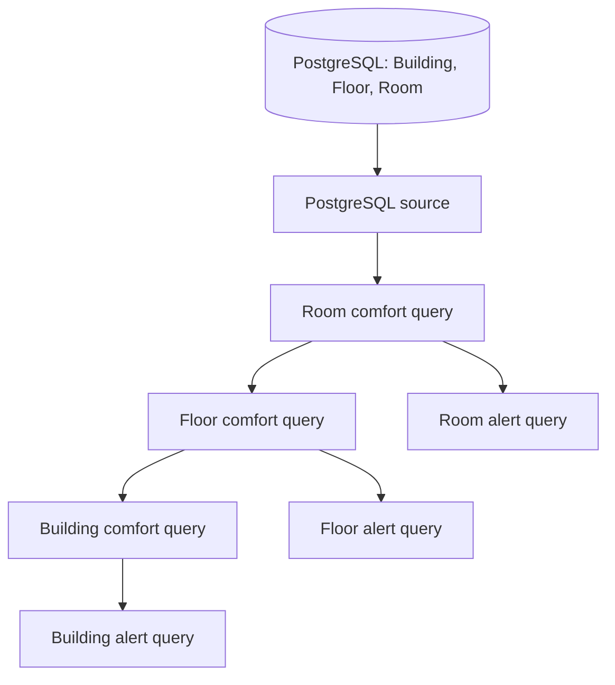
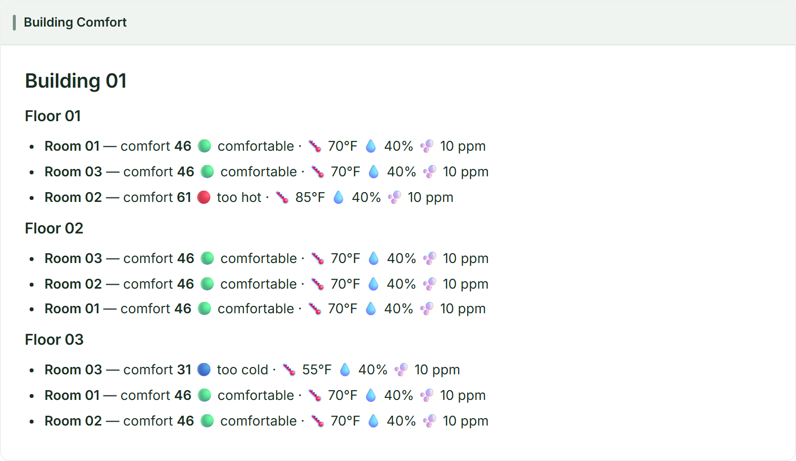

Imagine you manage a building and want to know — the instant it happens — when any room becomes uncomfortable: too hot, too cold, or stuffy with CO2. You don't want to poll sensors on a timer or wire up a stream processor by hand. You just want to describe what "uncomfortable" means and have something watch every room, floor, and the whole building for you, continuously.

This tutorial builds a **Building Comfort** monitoring demo on **Drasi Server**. A PostgreSQL database holds a building made of floors and rooms, each room reporting `temperature`, `humidity`, and `co2`. You'll start Drasi Server with a single configuration, watch a live dashboard light up, and then change room readings and see everything react in real time — without writing any application code, and **without building a bespoke web UI**. Instead of a hand-written dashboard, the demo uses Drasi Server's built-in **dashboard reaction**.

## The graph you'll run {#graph}

A **source** supplies data changes, a **continuous query** keeps a calculated
result up to date, and a **reaction** presents or acts on those results. Here,
queries also feed other queries: calculate each room's comfort once, reuse
those scores for floor averages, then reuse the floor averages for the building.
Scores from **40 through 50, inclusive**, are comfortable; scores outside that
band produce alerts.



The **dashboard subscribes to all six query outputs**. The **console log
subscribes to the three alert outputs**. One calculation can therefore serve
several consumers; this is *fan-out*. An alert filter and the dashboard reuse
the same room result rather than recalculating its comfort independently.

The source and every query **emit graph changes**. A query represents each
result row as a node: its returned columns become properties, and changes to
the row add, replace or delete that node. Because query inputs accept the same
format, the next query can process those changes directly, with no conversion
component. The dashboard presents the maintained results, not just the latest
individual change.

For example, changing one room reading changes its score, which changes its
floor average, which changes the building average. At each level, a separate
alert query keeps only results outside the comfortable band. The exercises
below let you follow this path and watch alerts appear and disappear.

| Step | What You'll Do | Time |
| ---- | ------------- | ---- |
| **[Step 1: Set Up Your Environment](#setup)** | Build matching Server and plugin binaries from the existing checkouts | Depends on build cache |
| **[Step 2: Run the Demo](#run)** | One command starts PostgreSQL and Drasi Server | 3 min |
| **[Step 3: Open the Dashboard](#dashboard)** | Watch comfort levels and alerts live | 2 min |
| **[Step 4: Drive Change](#drive)** | Break, reset, and simulate rooms — and watch Drasi react instantly | 5 min |
| **[How It Works](#how)** | Connect the graph to its query inputs, output labels, joins and dashboard configuration | 5 min |

{}
- **Terminals:** you'll use two. **Terminal 1** runs the demo (it stays in the foreground). Use **Terminal 2** for the helper scripts that change data.
- **Working directory:** run every command from the tutorial directory (`tutorials/building-comfort/`). The dev container opens there automatically; if you're running locally, `cd tutorials/building-comfort` first.
- **Platform:** use macOS, Linux, or WSL with Python 3.11 or newer. All commands below use the same Python helper; there are no separate shell-specific implementations.
- **Ports:** the Drasi Server API is on `8380`, the dashboard is on `3000`, and PostgreSQL is published on `5732`.
- **Runtime:** this tutorial builds the ComputationGraph version of Drasi Server from matching local Server and Core checkouts, not a published Server release.
{}

## Step 1 of 4: Set Up Your Environment {#setup}

### Use the existing source checkouts

Keep these repositories beside one another, on their matching
`agentofreality-parallel-computation-graph` branches:

```text
workspace/
  drasi-core/
  drasi-server/
  learning-drasi-server/
```

The build helper does not clone repositories, switch branches, download released
Drasi binaries, or change dependencies. Server must reference `../drasi-core/lib`
in its Cargo manifest. The ordinary PostgreSQL and reaction interfaces remain
supported: they run inside ComputationGraph without requiring native graph YAML.

For a local build, install Python 3.11+, Rust through rustup, a C/C++ compiler,
CMake, Clang/libclang, pkg-config, jq with its development library, OpenSSL
development files, and `protoc`. Use a Rust toolchain supported by the matching
checkouts; this tutorial's qualification uses **Rust 1.95.0**. PostgreSQL runs in
**Podman with a Compose provider**. Start the Podman machine first on macOS.
Docker Compose is also supported when you explicitly set `CONTAINER_ENGINE=docker`.

On Debian/Ubuntu the native prerequisites are:

```bash
sudo apt-get install build-essential cmake clang libclang-dev pkg-config \
  libjq-dev libssl-dev protobuf-compiler python3
```

On macOS, use the Xcode command-line tools and Homebrew's `cmake`, `llvm`,
`pkg-config`, `jq`, `openssl@3`, and `protobuf`. If linking cannot locate jq, set
`JQ_LIB_DIR="$(brew --prefix jq)/lib"` and `LIBRARY_PATH` to that directory.
Do not enable bundled jq or build the entire workspace with `--all-features`.

From `learning-drasi-server/`:

```bash
cd tutorials/building-comfort
```

If the Core checkout has no workspace `Cargo.lock` yet, generate it before the
locked build. Keep an existing lockfile unchanged:

```bash
RUSTUP_TOOLCHAIN=1.95.0 cargo generate-lockfile --manifest-path ../../../drasi-core/Cargo.toml
```

Then build the matching artifacts:

```bash
RUSTUP_TOOLCHAIN=1.95.0 python3 scripts/demo.py build
```

This builds Server and exactly four plugins from the sibling Core checkout:
PostgreSQL source, PostgreSQL bootstrap, dashboard reaction, and log reaction.
It uses `drasi-server/target` by default, then copies a matching set into the
tutorial's private `.runtime/builds/` directory. `.runtime/build.json` records
repository revisions, working-tree status, compiler version, and artifact hashes.
Build and verification use the repository's shared `scripts/local_build.py`;
this tutorial keeps its own artifact bundle and database lifecycle.
Rebuild after changing Server or Core.

The dashboard's web assets are embedded in its plugin. This tutorial does not
require the separate Server management UI or a Node.js build.

### Optional local dev container

Open this repository in VS Code, choose **Reopen in Container**, and select
**Drasi Server - Building Comfort Tutorial**. Keep all three checkouts present
first: this configuration mounts their parent directory and installs the build
prerequisites. Its post-create script checks that Core's workspace `Cargo.lock`
exists before running the same locked build, with a container-specific Cargo
target directory. If that check fails, generate the lockfile using the command
above in the container terminal, then rerun:

```bash
bash ../../.devcontainer/building-comfort/post-create.sh
```

This source-based setup is **not a one-click Codespaces or release-ZIP setup**.
Those environments need the matching Core and Server checkouts too. The former
`0.2.0-preview` downloads are deliberately no longer offered for this tutorial.

### Optional settings

Copy `.env.example` to `.env` to change ports or select Docker. The helper reads
literal `NAME=value` entries; exported variables take precedence. Change
`POSTGRES_PORT` and `POSTGRES_HOST_PORT` together. Services bind to loopback by
default; do not expose the demo credentials or dashboard publicly.

The new database uses the `building-comfort-cg` Compose project. It does not
reuse or delete the old tutorial's database. Server writes its local runtime
files under `.runtime/`, not the former `data/` directory.

## Step 2 of 4: Run the Demo {#run}

Everything runs from a single configuration file, `server-config.yaml`. In **Terminal 1**, start the demo:

```bash
python3 scripts/demo.py start-demo
```

The helper verifies the local artifact hashes before touching the database.
It starts PostgreSQL, seeds an empty database with one building, three floors,
and nine comfortable rooms, and runs Server in the foreground. Repeating the
command preserves existing database contents; it does not drop tables or volumes.

Server loads only the four prepared local plugins. `autoInstallPlugins: false`
prevents release downloads. The helper passes `--skip-verification` specifically
for these locally built, hash-checked plugins, which do not have registry
signatures. It does not change global plugin-verification settings or use the
global plugin cache.

Wait for the helper's readiness message, not merely the API-started log line:

```text
Building Comfort READY: ComputationGraph; source, six queries and two reactions running.
```

Leave this running. Everything else happens from **Terminal 2** (or your browser).

{}
Press **Ctrl+C** in Terminal 1 to stop Server. To stop PostgreSQL while preserving
its data, run `python3 scripts/demo.py cleanup`. Add `--volumes` only when you
intend to delete this demo's database. No command kills other Server processes.
{}

## Step 3 of 4: Open the Dashboard {#dashboard}

Drasi Server's dashboard reaction hosts a live web dashboard — there's no separate
app to build or run. After the **Building Comfort READY** message, open:

```text
http://localhost:3000
```

In the local dev container, port `3000` is forwarded automatically and appears
as **Comfort Dashboard** in VS Code's **Ports** panel. Select the predefined
**Building Comfort** dashboard if the dashboard list is shown first.

You'll see the **Building Comfort** dashboard:

- **Building Comfort** (the large panel) — the building grouped by floor, with each room's comfort level and sensor readings. Every room starts at comfort `46` (comfortable).
- **Building Comfort** KPI and **gauge** — the building's overall comfort level.
- **Comfort Alerts** and **Floor Alerts** — empty for now; rooms and floors appear here only when they need attention.
- **Floor Comfort** — a table of each floor's comfort level.

The dashboard updates the instant the data changes — no refreshing. Let's make something change.

## Step 4 of 4: Drive Change {#drive}

With Terminal 1 running the demo and the dashboard open, use **Terminal 2** to change room readings and watch Drasi react.

{}
The data-changing commands below write ordinary SQL changes to PostgreSQL.
They do not call Server or publish artificial query results. Drasi
observes those changes through logical replication, updates the queries, and
sends result changes to the dashboard.
{}

### Break a room

Push a single room out of the comfortable band (sets `temperature = 40`, `humidity = 20`, `co2 = 700`):

```bash
python3 scripts/demo.py break-room room_01_01_01
```

**Room 01** on **Floor 01** changes from comfort `46` to `4`, and its status
becomes blue (too cold). Floor 01 becomes `32`, and building comfort becomes
approximately `41.3333`. Room and floor alerts appear, but **no building alert**
appears: the building average is still within 40-50. Terminal 1 logs the alerts.

Follow the one database update through the graph:

| Stage | What changes | Who reuses that output |
| --- | --- | --- |
| Room comfort | The room's existing result node is replaced with score `4` and its new readings | Floor calculation, room-alert filter, dashboard |
| Floor comfort | Floor 01's average becomes `32`; the other two floors remain at `46` | Building calculation, floor-alert filter, dashboard |
| Building comfort | The average of `32`, `46`, and `46` becomes approximately `41.3333` | Building-alert filter, dashboard |

The alert queries do not repeat these calculations. They test the corresponding
maintained score: room `4` and floor `32` are below `40`, while building
`41.3333` is not. Dashboard branches update independently as changes arrive;
the graph does not make all widgets refresh atomically or in a fixed visual order.

### Reset a room (or all rooms)

Return a room — or the whole building — to comfortable defaults (`70 / 40 / 10`):

```bash
# Reset one room
python3 scripts/demo.py reset-room room_01_01_01

# Reset every room
python3 scripts/demo.py reset-room
```

The room's result node is replaced again, this time with score `46`. Its floor
and building averages return to `46`. The room and floor no longer match their
alert filters, so those queries emit **deletions of their alert result nodes**.
That is why the alert lists clear without a separate "clear alert" command.
The underlying room has not been deleted.

### Set custom values

Try partial degradation — make a room too hot without touching CO2:

```bash
# set-room <room_id> <temperature> <humidity> <co2>
python3 scripts/demo.py set-room room_01_02_03 82 40 10
```

Starting with the other rooms reset, this gives room comfort `58`, floor comfort
`50`, and building comfort approximately `47.3333`. **Only the room alerts**:
the floor is exactly on the comfortable upper boundary.

To see a building alert too, reset everything and break two rooms:

```bash
python3 scripts/demo.py reset-room
python3 scripts/demo.py break-room room_01_01_01
python3 scripts/demo.py break-room room_01_01_02
```

Floor 01 becomes `18`, and building comfort becomes approximately `36.6667`.
All three kinds of alert now have results. The building alert is visible in
Terminal 1's log; the room and floor alerts also appear in the dashboard lists.
Reset all rooms to clear them.

### Check why floor sizes matter

The building gives each floor equal weight, not each room. With three rooms on
every floor, both methods give the same answer and can hide a mistaken query.
Predict the extra-room result: the original nine rooms have
score `46`, and the extra room has score `58`. Floor 01 now has four rooms; the
other floors still have three.

| Calculation | Expected value |
| --- | --- |
| Floor 01: average of `46`, `46`, `46`, `58` | `49` |
| Building: average of floor scores `49`, `46`, `46` | `47` |
| Average of all ten room scores, which this demo does **not** use | `47.2` |

Now run the exercise while Server is running and the simulator is stopped.
This data-changing check requires exactly the nine seeded rooms. It resets
their readings for its scenarios, inserts the temporary hot room on Floor 01,
then removes it and restores your original readings. It checks all six query
results and dashboard snapshots after each scenario; no query results are
fabricated.

```bash
python3 scripts/verify_demo.py --exercise --output .runtime/comfort-exercise.json
```

Look for `Unequal floors: Floor 01 = 49; building = 47` in the terminal output.
The JSON file preserves that scenario's six result sets even after the
temporary room is removed. Its removal must also remove the room's alert and
return the floor and building averages to `46`.

### Let it run hands-free

To keep the dashboard alive without typing, run the simulator. It picks a random room every few seconds and assigns new readings, so comfort levels rise and fall and alerts come and go on their own:

```bash
python3 scripts/demo.py simulate

# Or make just three changes, one second apart:
python3 scripts/demo.py simulate 1 --count 3
```

Press **Ctrl+C** to stop the simulator, then run `python3 scripts/demo.py reset-room`.
Reset-all sends a single multi-row SQL update; every changed room must reach the
queries and dashboard.

### Stop and restart without losing your source data

Set a room to an uncomfortable value, stop Server with Ctrl+C, and run
`python3 scripts/demo.py start-demo` again. PostgreSQL retains your readings.
The source first supplies a snapshot of the current database rows and then
supplies live changes. The room query uses that initial data to establish its
result. Each downstream query likewise starts with its upstream query's current
output and then follows changes. This initial-state loading is called
**bootstrap**; a consumer does not have to wait for every room to change before
showing the current picture.

The dashboard returns to the same state. Layout edits and query/API changes are
not persisted by this tutorial configuration. If readings change while Server
is stopped, restart restores the current picture; this is not an alert-history
service that promises to replay every alert transition during the outage.

This is a normal restart and fresh bootstrap, **not** a claim of durable query
indexes, crash-safe browser delivery, or exactly-once external effects.

## How It Works {#how}

Everything you just ran is described by the single `server-config.yaml`. The
named instance `building-comfort-server` owns one ComputationGraph containing
the source, six queries and two reactions. Its ports are the components'
connection points, and its pipes carry changes between them. Server creates
these connections from the query `inputs` and reaction `queries` declarations.

The convenient `sources`, `queries` and `reactions` sections do not create a
second runtime. Each query runs as a `ContinuousQueryTransformer` inside that
graph. There is no need for custom arithmetic transformers or lower-level
factory configuration to express this demo.

### The Source

```yaml
sources:
  - kind: postgres
    id: building-facilities
    autoStart: true

    # Connection (supplied via environment variables, with defaults)
    host: "${POSTGRES_HOST:-localhost}"
    port: ${POSTGRES_PORT:-5732}
    database: "${POSTGRES_DATABASE:-building_comfort}"
    user: "${POSTGRES_USER:-drasi_user}"
    password: "${POSTGRES_PASSWORD:-drasi_password}"
    sslMode: prefer

    # Tables to monitor (PascalCase so node labels match the queries)
    tables:
      - Building
      - Floor
      - Room

    # Logical replication slot + publication
    slotName: drasi_building_comfort_slot
    publicationName: drasi_building_comfort_pub

    # Primary key of each table, so Drasi can track row identity
    tableKeys:
      - table: Building
        keyColumns:
          - id
      - table: Floor
        keyColumns:
          - id
      - table: Room
        keyColumns:
          - id

    # Load the rows that already exist when the server starts
    bootstrapProvider:
      kind: postgres
```

The PostgreSQL source connects with the credentials above (provided via environment variables, with sensible defaults) and uses **logical replication (CDC)** to stream changes from the `Building`, `Floor`, and `Room` tables. `tableKeys` tells Drasi the primary key of each table so it can track row identity across changes. The bootstrap provider loads the rows that already exist when the server starts; after that, every `UPDATE` you make (via the helper scripts) flows to Drasi as a change. The table names are quoted and PascalCase so the node labels Drasi sees match the queries exactly: `(r:Room)`, `(f:Floor)`, `(b:Building)`. For every option the source accepts, see [Configure the PostgreSQL Source](https://drasi.io/drasi-server/how-to-guides/configuration/configure-sources/configure-postgresql-source/).

### The Continuous Queries

The room query computes a **comfort level** once per room. The other queries
reuse its maintained results rather than repeating the formula or database
joins. A value between **40 and 50** is comfortable; the seed values (70°F, 40%,
10 ppm) give `50 + (70-72) + (40-42) + 0 = 46`.

```cypher
floor( 50 + (r.temperature - 72) + (r.humidity - 42)
      + CASE WHEN r.co2 > 500 THEN (r.co2 - 500) / 25 ELSE 0 END )
```

There are six queries:

| Query | Input component | Output: graph changes to nodes labeled |
| ----- | ----- | --------------- |
| `room-comfort` | `building-facilities` | `RoomComfort`: one per room, with readings, score and floor/building context |
| `floor-comfort-level-calc` | `room-comfort` | `FloorComfort`: one per floor, with its score and building context |
| `building-comfort-level-calc` | `floor-comfort-level-calc` | `BuildingComfort`: one per building, with its score |
| `room-alert` | `room-comfort` | `RoomAlert`: only rooms whose score is outside 40–50 |
| `floor-alert` | `floor-comfort-level-calc` | `FloorAlert`: only floors whose score is outside 40–50 |
| `building-alert` | `building-comfort-level-calc` | `BuildingAlert`: only buildings whose score is outside 40–50 |

The query **ID** selects a component to connect to; the result **label** tells a
downstream `MATCH` which kind of node to read. For example,
`inputs: [room-comfort]` connects to the room query, while
`MATCH (r:RoomComfort)` reads the nodes it produces. `result.label` declares that
label; it does not select a different message format. All six use
`drasi.graph-change` v1.

Every returned alias is a property on the result node. `RoomId`, for example,
is a business identifier carried as a property; Drasi also supplies the result
node's own stable identity so a consumer can apply replacements and deletions.
The floor query retains `BuildingId` and `BuildingName` in its output so the
next query can group by building without joining the original tables again.
Each query maintains its own input and result state; the benefit is reusing
an upstream calculation, not sharing one mutable store between queries.

#### Synthetic joins connect the entities

PostgreSQL knows `Room.floor_id` references `Floor.id` through a foreign key, but
Drasi doesn't read foreign keys. The room query declares the two synthetic joins
once, so it can return both the room's measurements and its floor/building context:

```yaml
inputs:
  - component: building-facilities
    nodes:
      - Room
      - Floor
      - Building
joins:
  - id: PART_OF_FLOOR
    keys:
      - label: Room
        property: floor_id
      - label: Floor
        property: id
  - id: PART_OF_BUILDING
    keys:
      - label: Floor
        property: building_id
      - label: Building
        property: id
```

With those joins declared, the room query matches the whole hierarchy:

```cypher
MATCH (r:Room)-[:PART_OF_FLOOR]->(f:Floor)-[:PART_OF_BUILDING]->(b:Building)
```

#### Aggregating up the hierarchy

The floor query reads `RoomComfort` nodes, grouping by their floor and building
properties. It needs neither the original database joins nor the room formula:

```yaml
- id: floor-comfort-level-calc
  inputs: [room-comfort]
  result:
    label: FloorComfort
  query: |
    MATCH (r:RoomComfort)
    RETURN r.FloorId AS FloorId, r.FloorName AS FloorName,
      r.BuildingId AS BuildingId, r.BuildingName AS BuildingName,
      avg(r.ComfortLevel) AS ComfortLevel
```

The building query averages those floor results. Each floor contributes once,
so a floor with more rooms does not receive extra weight:

```yaml
- id: building-comfort-level-calc
  inputs: [floor-comfort-level-calc]
  result:
    label: BuildingComfort
  query: |
    MATCH (f:FloorComfort)
    RETURN f.BuildingId AS BuildingId, f.BuildingName AS BuildingName,
      avg(f.ComfortLevel) AS ComfortLevel
```

Alerts are simple filters over the corresponding maintained output. For example,
the building alert does no aggregation itself:

```yaml
- id: building-alert
  inputs: [building-comfort-level-calc]
  result:
    label: BuildingAlert
  query: |
    MATCH (b:BuildingComfort)
    WHERE b.ComfortLevel < 40 OR b.ComfortLevel > 50
    RETURN b.BuildingId AS BuildingId, b.BuildingName AS BuildingName,
      b.ComfortLevel AS ComfortLevel
```

The result is the set of **currently uncomfortable** buildings, not an
append-only history. Entering the band removes a building from that result;
leaving it adds the building. A changed score while it remains uncomfortable
replaces its existing alert result. The room and floor alert queries follow
the same rule over their corresponding inputs.

### The Dashboard Reaction

```yaml
reactions:
  - kind: dashboard
    id: building-comfort-dashboard
    queries:
      - room-comfort
      - building-comfort-level-calc
      # ...
    port: 3000
    predefinedDashboards:
      - id: building-comfort
        name: Building Comfort
        widgets:
          # ...
```

The dashboard reaction subscribes to all six queries and streams their changes
to the browser over a WebSocket. It maintains the rows for each output, applying
additions, replacements and deletions. A **predefined dashboard** supplies the
initial layout. The large building panel reads `room-comfort`, the floor table
reads `floor-comfort-level-calc`, and both the KPI and gauge read
`building-comfort-level-calc` directly. They do not recalculate the building
average from the room rows.

The room and floor alert lists display their alert-query results. The log
reaction independently subscribes to all three alert queries, including
`building-alert`; no extra query is created for the log. Formatting a score as a
colored room status is presentation work, not another comfort calculation.
The full widget options are documented in
[Configure the Dashboard Reaction](https://drasi.io/drasi-server/how-to-guides/configuration/configure-reactions/configure-dashboard-reaction/).

For example, the centerpiece **Building Comfort** panel is a single Markdown
widget. Its template groups the `room-comfort` rows by floor with `groupBy`,
loops over the rooms with `each`, and uses `gt`/`lt` comparisons to pick a status
emoji per comfort level:

```handlebars
{{#groupBy rows "FloorName"}}
### {{@key}}
{{#each this}}
- **{{this.RoomName}}** — comfort **{{this.ComfortLevel}}**
    {{#if (gt this.ComfortLevel 50)}}
      🔴 too hot
    {{else}}
      {{#if (lt this.ComfortLevel 40)}}
        🔵 too cold
      {{else}}
        🟢 comfortable
      {{/if}}
    {{/if}}
    · 🌡️ {{this.Temperature}}°F  💧 {{this.Humidity}}%  🫧 {{this.CO2}} ppm
{{/each}}
{{/groupBy}}
```

And the reaction renders it live:



### Inspect the running graph

You do not need an `executionMode` field or an enablement flag. The single output
on each query resolves automatically; an input with several outputs requires an
explicit port or a declared primary.

Check the running components at any time:

```bash
python3 scripts/demo.py check
```

The check requires the selected instance to report `runtime: "computationGraph"`
and `running: true`, with the source, all six queries and both reactions running,
and the predefined dashboard available. It is a readiness check, not proof that
every input has finished processing.

To compare every query and dashboard snapshot with the current PostgreSQL rows
without modifying data, run `python3 scripts/verify_demo.py`. The
[migration notes](migration.md) also describe the repeatable, data-changing
acceptance exercises.

{}
You can also query Drasi Server's REST API while the demo runs — see `requests.http` for ready-made requests, for example:

```text
GET http://localhost:8380/api/v1/instances/building-comfort-server/queries/room-comfort/results
GET http://localhost:8380/api/v1/instances/building-comfort-server/queries/room-alert/results
```
{}

## Clean Up {#cleanup}

When you're finished, stop Drasi Server with **Ctrl+C** in Terminal 1, then remove the database container:

```bash
# Stop containers, keep data
python3 scripts/demo.py cleanup

# Only when you intend to delete this demo's database:
python3 scripts/demo.py cleanup --volumes
```

Cleanup checks this tutorial's ownership labels and never kills processes by
name. The old tutorial's containers, volumes and files are not touched. Local
builds and the build record remain available for another run.

## Migration Notes {#migration}

See [Migrating Building Comfort to ComputationGraph](migration.md) for the exact
runtime, plugin, configuration, helper and documentation changes, what stayed
the same, and the acceptance checks used for this tutorial.

## What You Learned {#summary}

- **Sources** connect Drasi Server to live data — here, PostgreSQL via Change Data Capture.
- **Continuous queries emit graph changes**, so the room calculation can feed floor and building calculations directly. Only the room query needs the original table joins and comfort formula.
- **Fan-out** lets rollups, alert filters and presentation reuse those maintained outputs without repeating the calculation.
- **Alerts are maintained results**: matching entities appear, change and disappear as their scores cross the comfortable band.
- **Reactions** present or act on those results. The dashboard supplies a live UI without application code, while the log independently consumes the alert outputs.
- **Bootstrap and live changes** establish the current picture and keep it current. Restarting from PostgreSQL is different from guaranteeing delivery of every historical alert.

From here, try editing the comfort formula or the dashboard widgets in `server-config.yaml`, adding a new alert query, or pointing the dashboard at your own data.
