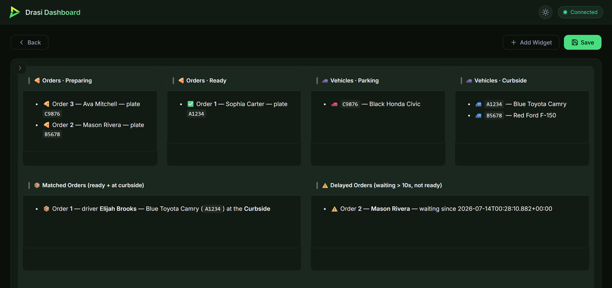
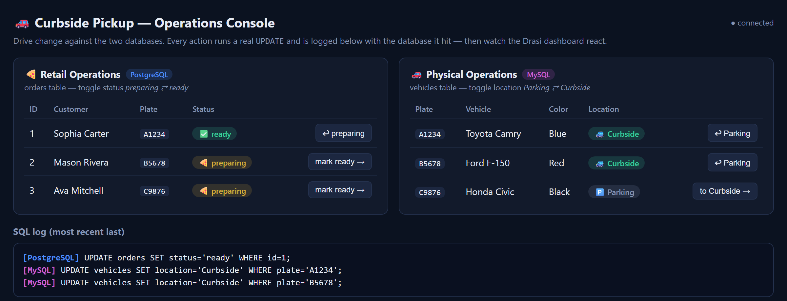

Imagine a store running curbside pickup. The **retail team** manages customer orders in PostgreSQL and marks an order *ready* when it is prepared. Independently, the **physical operations team** tracks vehicles in MySQL, and a driver sets their location to *Curbside* when they arrive. The two systems never talk to each other.

You want one live dashboard with six panels:

- 🍕 **Orders · Preparing** and **Orders · Ready**, so an order moves between panels when staff mark it ready.
- 🚗 **Vehicles · Parking** and **Vehicles · Curbside**, so a car moves between panels as the driver pulls up.
- 📦 **Matched Orders**, showing ready orders whose drivers are at the curbside.
- ⚠️ **Delayed Orders**, flagging drivers waiting at the curbside for more than 10 seconds while their orders are not ready.

Polling one database and looking up rows in the other leaves a blind spot between polls. Drasi watches **both change feeds** instead. A PostgreSQL order change or a MySQL vehicle change updates the same cross-database join immediately. The computation graph calculates that join **once**, then feeds separate delivery and delay queries. The built-in dashboard reaction displays the six panels automatically; there is no dashboard application code to write.

A small **operations console** stands in for the two teams. You click its buttons to make real database changes, and it shows every SQL `UPDATE` and which database received it.

| Step | What You'll Do |
| ---- | ------------- |
| **[Step 1: Set Up Your Environment](#setup)** | Build matching local Server/Core and plugins |
| **[Step 2: Run the Demo](#run)** | Start both databases, Drasi Server, and the operations console |
| **[Step 3: Open the Dashboard](#dashboard)** | Watch all six panels update live |
| **[Step 4: Drive Change](#drive)** | Change orders and vehicles in the browser |
| **[How It Works](#how)** | Understand CDC, the shared join, query chaining, and timers |

{}
- Run commands from `tutorials/curbside-pickup/`.
- One foreground command runs Server and the operations console. You drive changes in your browser.
- Default ports: API `8480`, dashboard `3000`, console `3001`, PostgreSQL `5742`, MySQL `3309`.
- This tutorial uses the existing sibling `drasi-server/` and `drasi-core/` checkouts. It does not download released Drasi binaries or plugins, clone repositories, or switch branches.
{}

## Step 1 of 4: Set Up Your Environment {#setup}

The workspace must contain these three existing checkouts:

```text
workspace/
  drasi-core/
  drasi-server/
  learning-drasi-server/
```

Server must reference `../drasi-core/lib` as a local path dependency. Use the matching ComputationGraph versions already checked out in this workspace. A Server binary alone is insufficient: its **five dynamic plugins** must be rebuilt against the same local Core/SDK.

### Option A: Local Dev Container

Open `learning-drasi-server` in VS Code, run **Reopen in Container**, and choose **Drasi Server - Curbside Pickup Tutorial**. The configuration mounts the parent workspace so the existing Core and Server checkouts are visible. Setup installs build prerequisites, Podman/Compose and the console dependencies, then builds matching local Server and plugins.

The container opens in this tutorial directory. Continue to [Step 2](#run). A Codespace created from only `learning-drasi-server` does **not** provide the required sibling sources; setup fails explicitly rather than downloading a different Drasi release.

### Option B: Run Locally

You need **Podman with a working Compose provider**, **Python 3.11+**, **Node.js 18+ with npm**, and **Rust 1.95.0** with the native build dependencies required by the local Server/Core checkouts. On macOS or Windows, start your Podman machine first. On Windows, use a supported Rust native toolchain, or WSL with the same sibling checkout layout.

From `learning-drasi-server`, enter the tutorial and build:



cd tutorials/curbside-pickup
(cd webui && npm ci)
RUSTUP_TOOLCHAIN=1.95.0 CARGO_BUILD_JOBS=1 python3 scripts/demo.py build


cd tutorials/curbside-pickup
Push-Location webui
npm ci
Pop-Location
$env:RUSTUP_TOOLCHAIN = "1.95.0"
$env:CARGO_BUILD_JOBS = "1"
python scripts/demo.py build



The shared source-build helper builds Server and `source/postgres`, `bootstrap/postgres`, `source/mysql`, `bootstrap/mysql`, and `reaction/dashboard`. It records provenance and artifact hashes in `.runtime/build.json` and copies the complete build into a private, content-addressed bundle. Startup verifies that bundle; it does not search `PATH`, reuse an old `bin/`, or load the global plugin cache. Rebuild after changing Server or Core.

Build dependencies may need to be fetched the first time. For an already provisioned offline workspace, set `CARGO_NET_OFFLINE=true`. Serialize builds when sharing a Cargo target directory with another tutorial or agent.

To change ports, copy `.env.example` to `.env` and edit it before starting. Each database's `*_PORT` and `*_HOST_PORT` must match. To run another isolated copy, also choose a distinct `COMPOSE_PROJECT_NAME`, a distinct `DRASI_DEMO_DIR`, and five free ports. The provided database identities and demo credentials match the seed SQL; these local demonstration credentials are not a production security configuration.

## Step 2 of 4: Run the Demo {#run}

The graph and dashboard are defined in [`server-config.yaml`](server-config.yaml). Start the complete demo:



bash scripts/start-demo.sh


powershell -ExecutionPolicy Bypass -File scripts/start-demo.ps1



The helper:

1. Verifies the matching local artifact bundle, then starts **owned, labeled** PostgreSQL and MySQL containers. It initializes empty databases with three preparing orders and three parked vehicles. Re-running it **preserves existing database rows** rather than deleting volumes or reseeding.
2. Starts Drasi Server with plugin auto-install disabled and only the five verified local plugin files. Signature verification is bypassed specifically for these locally built development plugins, not registry downloads.
3. Starts the operations console and waits for this instance's ComputationGraph, both sources, all seven queries, the dashboard reaction, and both console database connections to be ready.

Wait for:

```text
Curbside Pickup READY: ComputationGraph; two sources, seven queries, six panels.
```

Leave this terminal running. An API listener alone is not proof that the graph or databases are ready.

{}
Press **Ctrl+C** to stop Server and the console together. The databases and their data remain. Run the same start command to resume from current database contents.

An already-open dashboard reconnects automatically after Server restarts. It replaces every panel with a fresh snapshot, including clearing rows that disappeared while disconnected, then resumes live changes. You do not need to reload the page.

Use `bash scripts/cleanup.sh` (or `powershell -File scripts/cleanup.ps1`) after stopping the demo to remove only its owned containers/network while keeping volumes. Add `--volumes` only when you explicitly want to delete this run's database data. Cleanup never kills other Server processes and refuses resources with a different ownership label.
{}

### What startup restores

Each source bootstraps current table rows and then streams live CDC. Query chaining propagates those rows through the shared join and the two decisions. A newly opened dashboard obtains current query snapshots and receives subsequent changes.

This demo has **no durable graph state or event-replay guarantee**. Database volumes persist, but in-memory results and temporal timers are reconstructed on Server restart. The displayed vehicle-change timestamp after bootstrap is an observation timestamp, not a durable record of the driver's original arrival time. Do not treat this configuration as exactly-once delivery, historical replay, or timer continuity across downtime.

## Step 3 of 4: Open the Dashboard {#dashboard}

After the readiness message, open:

```text
http://localhost:3000
```

Open the seeded **Curbside Pickup** dashboard. The six Markdown panels are arranged in two rows: the four orders/vehicles lists above, with matched and delayed orders below. The dev container forwards the dashboard port automatically.

On a **fresh database**, all three orders are in **Orders · Preparing** and all three vehicles are in **Vehicles · Parking**. **Orders · Ready**, **Vehicles · Curbside**, **Matched Orders**, and **Delayed Orders** start empty. On restart, panels reflect the preserved database state instead.



Every panel updates without a browser refresh. A row leaving one filtered query disappears from its panel and appears in the other.

## Step 4 of 4: Drive Change {#drive}

Open the operations console in another tab or window:

```text
http://localhost:3001
```

It has **Retail Operations** (PostgreSQL orders), **Physical Operations** (MySQL vehicles), and a color-coded SQL log. Each row has a button: *mark ready →* or *to Curbside →*, and a corresponding button to move it back. Keep the dashboard visible alongside it.



### Trigger a delivery

Mark the order with plate **A1234** (Sophia Carter, order 1) **ready**. The console logs:

```text
[PostgreSQL] UPDATE orders SET status='ready' WHERE id=1;
```

Order A1234 leaves **Orders · Preparing** and appears in **Orders · Ready**. Now move vehicle **A1234** to **Curbside**:

```text
[MySQL] UPDATE vehicles SET location='Curbside' WHERE plate='A1234';
```

The vehicle moves from **Vehicles · Parking** to **Vehicles · Curbside**, and **Matched Orders** gains order 1 with its driver and blue Toyota Camry. The PostgreSQL and MySQL changes both flow through the same pickup join, then the delivery decision.

Move the vehicle back to **Parking**. It returns to that list, and the matched order disappears. Try the opposite order of actions too: first return the order to **preparing**, bring A1234 to the curb, then mark its order ready. A change from either database can complete the match.

### Trigger a delay

Move **B5678** (Mason Rivera's vehicle) to **Curbside**, but leave order B5678 **preparing**. The vehicle changes panels immediately. **Delayed Orders** stays empty initially, then shows order 2 after the condition has held for about **10 seconds**, without another database write.

`drasi.trueFor` schedules a future re-evaluation; no polling query is needed to discover the delay. Mark the order ready: its delayed entry disappears and a matched entry appears. Move the vehicle back to Parking to clear the match.

Also try canceling a wait: keep an order preparing, bring its vehicle to the curb, and send it back to Parking **before 10 seconds elapse**. No delayed entry should appear at the old deadline. Marking the order ready before the deadline cancels the delay too.

### Reset

Return all orders to preparing and all vehicles to Parking:



bash scripts/reset.sh


powershell -ExecutionPolicy Bypass -File scripts/reset.ps1



Preparing and Parking list all three rows again. The other four panels clear. Reset makes ordinary SQL changes, so you see the dashboard react without restarting it.

## How It Works {#how}

### Two sources in one computation graph

`retail-ops` reads PostgreSQL logical replication; `physical-ops` reads MySQL's binary log. PostgreSQL enables logical replication and publishes `orders`. MySQL enables ROW-based binlogs, full row images/metadata, and GTID mode, and grants the demo user replication privileges. Their bootstrap providers load existing rows.

Each `orders` row becomes an `orders` node; each `vehicles` row becomes a `vehicles` node. These ordinary source plugins participate in the **same ComputationGraph** as queries. Sources, queries, and transformers use the graph-change v1 data contract; a query can consume another query's output just as it consumes source nodes.

### Share the cross-database join

`pickup-state` connects the two sources by plate using a synthetic relationship. There is no cross-database foreign key:

```yaml
- id: pickup-state
  autoStart: true
  queryLanguage: Cypher
  inputs:
    - component: retail-ops
      nodes: [orders]
    - component: physical-ops
      nodes: [vehicles]
  result:
    label: Pickup
  joins:
    - id: PICKUP_BY
      keys:
        - label: orders
          property: plate
        - label: vehicles
          property: plate
  query: |
    MATCH (o:orders)-[:PICKUP_BY]->(v:vehicles)
    RETURN o.id AS orderId, o.status AS orderStatus,
           o.customer_name AS customerName,
           v.location AS vehicleLocation,
           drasi.changeDateTime(v) AS waitingSinceTimestamp
```

This abbreviated projection shows the key idea; the runnable configuration also carries the driver, vehicle description, and delivery timestamp needed by the panels. The explicit `result.label: Pickup` defines the label downstream queries match. Result identity comes from the graph; the order ID remains a display field.

`delivery` and `delay` both declare:

```yaml
inputs:
  - component: pickup-state
```

The downstream `MATCH (p:Pickup)` selects the label. Do not add the ordinary Source-plugin `nodes` subscription setting to a query-to-query input; it is not accepted for native graph producers.

Delivery matches `Pickup` nodes whose `orderStatus = 'ready'` and `vehicleLocation = 'Curbside'`. Delay uses:

```cypher
MATCH (p:Pickup)
WHERE drasi.trueFor(
  p.orderStatus <> 'ready' AND p.vehicleLocation = 'Curbside',
  duration({ seconds: 10 }))
RETURN p.orderId AS orderId,
       p.customerName AS customerName,
       p.waitingSinceTimestamp AS waitingSinceTimestamp
```

Both conditions are inside `trueFor`, so a ready order or a departing vehicle cancels the pending wait. The shared join carries the original vehicle observation timestamp as a property rather than asking for the downstream query node's change time.

The four list queries still read their respective source tables directly. In total there are **seven queries**, but only **six visible panels**: one reusable join plus the original six panel results. The extra graph stage removes two independent copies of the join; it does not add a new user workflow.

### Dashboard and operations console

The ordinary **dashboard reaction** remains query-aware: its `queries` list names the six panel queries, not `pickup-state`. Each widget names a query and renders its current rows using a Handlebars template. The matching local dashboard plugin sends an authoritative snapshot and subsequent live changes over the same WebSocket, using exact revision boundaries so overlapping changes cannot overwrite newer rows. Reconnecting replaces stale panel state rather than accumulating on top of it. No custom SSE client or producer-specific sink is needed.

The operations console is separate from Drasi. Its Express server runs real, parameterized SQL updates. It polls its own `/api/state` to reflect the two operational tables, but **the Drasi dashboard does not poll those databases**: its updates are CDC-driven. This distinction lets you inspect and change the source systems while observing a genuinely continuous dashboard.

The complete executable configuration is [`server-config.yaml`](server-config.yaml); keeping it in one file avoids a second copy of the graph drifting out of sync with the walkthrough.

### Check the running demo

`python3 scripts/demo.py check` verifies this instance's runtime identity and the required running components. `python3 scripts/verify_demo.py --allow-reset` additionally exercises the documented database changes, panel snapshots, timer threshold, cancellation, deletion, and reinsertion against an **isolated disposable run**. It changes and resets demo rows; do not run it against data you want to keep unchanged. Browser checks should also confirm the actual rendered panels update without refreshing.
