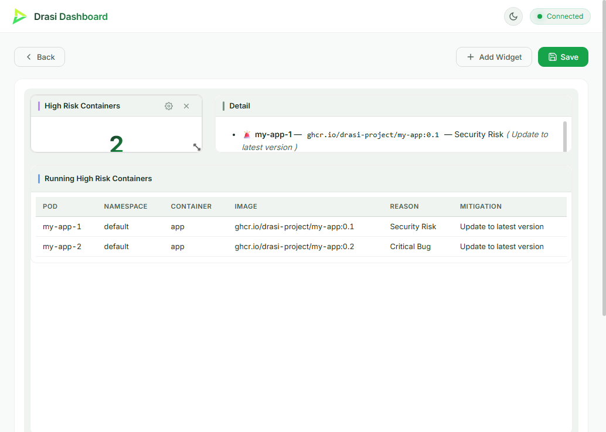

Imagine you keep a list of container images that are considered high risk
(known vulnerabilities, compliance problems, or images you don't want in
production), and want to know whenever one is used by a Pod in your Kubernetes
cluster. You don't want to write a controller or poll an API. You want to
describe the relationship between risky images and running applications, and
have something watch for the overlap continuously.

This tutorial builds a **High Risk Containers** dashboard on **Drasi Server**.
A PostgreSQL table holds risky image tags, a Kubernetes source watches real
Pods, and a reusable query publishes their container inventory. A second query
joins that inventory to the risky-image list. The **dashboard reaction** renders
the findings live, with no application code or bespoke web UI. An optional
**HTTP reaction** sends the same findings and resolutions to Discord.

The scenario stays small: two Pods, two initial risky-image records, one
dashboard, then an image flagged in PostgreSQL and a Pod upgraded in Kubernetes.
The reusable inventory is the computation-graph improvement: another query can
consume the same normalized containers without another Kubernetes watch or
another unwind pipeline.

| Step | What you'll do |
| ---- | -------------- |
| **[1. Set up](#setup)** | Build matching local Server, Core and plugins |
| **[2. Run](#run)** | Start an owned Kubernetes cluster, PostgreSQL and Server |
| **[3. Open the dashboard](#dashboard)** | See the initial high risk container |
| **[4. Drive change](#drive)** | Flag an image, upgrade a Pod, then reset |
| **[How it works](#how)** | Understand reusable results, the synthetic join and graph inspection |
| **[Optional Discord alerts](#discord)** | Deliver real added/deleted query changes as webhooks |

{}
- Use two terminals, both in `tutorials/high-risk-containers/`. Terminal 1 runs Server in the foreground; Terminal 2 changes data.
- Default loopback ports are API `8380`, dashboard `3000`, PostgreSQL `5732` and Kubernetes API `6550`. Copy `.env.example` to `.env` before the first run to change them.
- Python commands below use `python3`; on Windows use `python` with Python 3.11 or newer. The existing `.sh` and `.ps1` helpers delegate to the same runner.
- The runner writes build provenance, ownership and a private kubeconfig under `.runtime/`. Do not copy this directory between machines or delete its ownership record while resources exist.
{}

## Step 1 of 4: Set Up Your Environment {#setup}

### Existing local checkouts

Use this directory layout, with the matching computation-graph versions already
checked out:

```text
workspace/
  drasi-core/
  drasi-server/
  learning-drasi-server/
```

Server must depend on the sibling `drasi-core/lib` by path. This tutorial does
not clone repositories, switch branches, download a released Drasi binary, or
install registry plugins. A released Server or an old plugin cache is not a
substitute for a matching local build.

### Option A: Local dev container

Open the existing `learning-drasi-server` folder in VS Code, select **Reopen in
Container**, and choose **Drasi Server - High Risk Containers Tutorial**. The
container mounts the parent directory so both sibling source checkouts are
available. Setup installs build prerequisites and builds local artifacts.

A Codespace containing only this tutorial repository is not sufficient: the
matching Core and Server checkouts must also be present. The local container
uses its own Docker-in-Docker engine, not a Docker Desktop installation; the
host workflow below defaults to Podman.

### Option B: Run on the host

Install Python 3.11+, the Rust toolchain named by the local checkouts (currently
1.95.0), the Server/Core native build prerequisites, **Podman**, **k3d** and
**kubectl**. Start a rootful Podman machine if your host needs one. k3d requires
Podman's Docker-compatible API, not just the `podman` CLI.

On macOS, inspect the socket and set it for these terminal sessions:

```bash
podman machine inspect --format '{{.ConnectionInfo.PodmanSocket.Path}}'
export DOCKER_HOST=unix:///the/socket/path/printed/above
```

On Linux use the endpoint of your rootful Podman API service. Configure that
service explicitly if it is not running; the tutorial will not change your
system settings or fall back to an unrelated Docker daemon.

Then build:

```bash
cd tutorials/high-risk-containers
python3 scripts/demo.py build
python3 scripts/demo.py verify-build
```

The shared builder compiles Server and **separately rebuilds** these six dynamic
plugins from local Core: `drasi-source-postgres`, `drasi-bootstrap-postgres`,
`drasi-source-kubernetes`, `drasi-bootstrap-kubernetes`,
`drasi-reaction-dashboard` and `drasi-reaction-http`. It records revisions and
artifact hashes and stages a private bundle. Server startup checks those hashes
and does not use `PATH`, `bin/plugins` or a global plugin cache. Signature
verification is bypassed only for this explicit local development bundle.

Re-run `build` after changing either checkout. Stop this tutorial's Server
before rebuilding. The old `download.sh` / `download.ps1` entry points now call
this local build rather than downloading released artifacts.

## Step 2 of 4: Run the Demo {#run}

In **Terminal 1**:

```bash
python3 scripts/demo.py start-demo
```

The first run allocates a unique run ID and records it in
`.runtime/ownership.json`. It:

1. Creates a k3d cluster with a private kubeconfig and a run-specific namespace,
   then deploys the original `my-app-1` (`ghcr.io/drasi-project/my-app:0.1`) and
   `my-app-2` (`:0.2`) Pods. It waits for both Pods to be ready.
2. Starts an owned PostgreSQL container and volume. An empty database is seeded
   with `my-app:0.1` as a *Security Risk* and `redis:6.2.3-alpine` as a
   *Compliance Issue*.
3. Starts the verified local Server/plugin bundle with a private copy of
   `server-config.yaml`, scoped to this cluster's kubeconfig and namespace.

It never switches your global kubectl context. All Kubernetes helpers specify
the private kubeconfig, named context and namespace. Existing resources are
reused only after ownership checks, not because their names happen to match.

Wait for:

```text
High Risk Containers READY: ComputationGraph; both sources, both queries and reactions running.
```

This is stronger than an open API port: the runner verifies the exact instance
ID, `runtime: "computationGraph"`, `running: true`, source/query/reaction statuses,
graph failure/wait observations and dashboard availability. Inspect the graph
and Server logs if it fails. A missing Kubernetes tool, denied list/watch
permission, unavailable API or Pod image-pull failure is an error, not a
simulated successful run.

### Startup and restart guarantees

**First start:** the database is seeded only when empty, and the two Pods are
created only when the owned namespace has no Pods. The PostgreSQL bootstrap
loads existing risks; Kubernetes bootstrap lists existing Pods. The
`pod-containers` query publishes its inventory snapshot, and
`high-risk-containers` bootstraps from that derived output plus the risk table
before maintaining live results.

**Normal restart:** Ctrl+C stops only Server. Run `start-demo` again, or use
`python3 scripts/demo.py start` when the infrastructure is already running.
Neither command resets risk rows or reapplies the original Pod image tags.
Server re-reads the YAML and rebuilds query results from current source data.
`persistConfig: false` means REST configuration edits are not saved; put lasting
changes in `server-config.yaml`, then restart.

**Delivery limits:** these are ordinary Source and Reaction adapters in the
ComputationGraph runtime, not native transactional PostgreSQL replay components.
There is no persistent query checkpoint or durable HTTP outbox configured here.
The tutorial does not promise exactly-once alerts, uninterrupted delivery across
outages, or gap-free snapshot/CDC coordination. Re-bootstrap may deliver an
existing finding again; do not use Discord messages as an audit log.

**Reset and cleanup are explicit:** `reset` changes only the tutorial's added
risk record and its two Pod images. `cleanup` deletes the owned cluster and
database container, preserving the database volume unless `--volumes` is passed.
After cleanup, a later start recreates the Pods at their original tags, while
retained database rows remain as you left them.

## Step 3 of 4: Open the Dashboard {#dashboard}

After the READY message, open <http://localhost:3000> (or your configured
dashboard port). In the dev container, use the **High Risk Containers Dashboard**
entry in VS Code's **Ports** panel.

The predefined dashboard contains:

- **High Risk Containers** KPI: count of matching containers.
- **Running High Risk Containers** table: Pod, namespace, container, image,
  reason and mitigation.
- **Detail**: a Markdown list of findings, or an all-clear message.

On a fresh run there is exactly one finding: **my-app-1**, running `my-app:0.1`,
with reason *Security Risk*. The risky Redis image has no matching Pod and does
not appear. Changes stream to the browser without refresh.



The image illustrates the dashboard layout; use the live table and the API
results to observe your run's actual state.

## Step 4 of 4: Drive Change {#drive}

### Flag a new high risk image

In **Terminal 2**:

```bash
python3 scripts/demo.py add-risk
```

This executes the following operation against **this run's** PostgreSQL
container, with safely quoted SQL parameters:

```sql
INSERT INTO "RiskyImage" ("Id", "Image", "Reason", "Mitigation")
VALUES (101, 'ghcr.io/drasi-project/my-app:0.2', 'Critical Bug', 'Update to latest version')
ON CONFLICT ("Id") DO UPDATE SET
  "Image" = EXCLUDED."Image",
  "Reason" = EXCLUDED."Reason",
  "Mitigation" = EXCLUDED."Mitigation";
```

**my-app-2** appears with reason *Critical Bug* and the KPI becomes **2**.
PostgreSQL CDC drives the risk join; the Pod did not change and the inventory
query did not need another watch or a re-unwind. The helper accepts image,
reason and mitigation arguments if you want to try another risk.

### Upgrade a Pod to a safe image

```bash
python3 scripts/demo.py upgrade
```

This runs `kubectl set image pod/my-app-2 app=ghcr.io/drasi-project/my-app:0.3`
against the private kubeconfig/context/namespace and waits until the container
reports that image and is running and ready. **my-app-2** leaves the findings
and the KPI returns to **1**. The risk row still exists in PostgreSQL; it no
longer joins to this Pod's image.

The query reads the Pod's **configured container image** (`spec.containers`),
not an image digest attestation or a container-health test. The result may
change before the replacement container finishes starting. The helper waits
for the actual new container to become ready so a failed rollout is not
reported as a successful upgrade.

### Reset and repeat

```bash
python3 scripts/demo.py reset
```

This deletes risk row `101` and restores `my-app-1` to `:0.1` and `my-app-2`
to `:0.2`, without dropping the risk table or replication slot. The dashboard
returns to the single initial finding.

For direct Kubernetes inspection without touching your global context:

```bash
python3 scripts/demo.py kubectl get pods -o wide
```

## How It Works {#how}

### Two real sources

`devops` uses the ordinary PostgreSQL source and bootstrap plugins. The quoted,
PascalCase `"RiskyImage"` table and `"Image"`, `"Reason"` and `"Mitigation"`
columns match the labels and properties in the query. `REPLICA IDENTITY FULL`
supplies old values for deletes/updates; the primary key preserves identity.

`k8s` uses the ordinary Kubernetes source and bootstrap plugins. It lists and
watches Pods only in the owned namespace. Authentication uses the private
kubeconfig written by the runner. The current Kubernetes plugin flattens
selected properties: `name`, `namespace`, `phase` and `containers` are top-level
fields; `containers` represents `spec.containers`. This is not an unchanged
copy of the entire Kubernetes JSON document.

Both sources participate in the same computation graph as the queries and
reactions. Keeping these adapters does not select an older execution engine.

### Normalize once, publish reusable container inventory

The `pod-containers` query attaches an unwind pipeline to its Kubernetes input:

```yaml
inputs:
  - component: k8s
    nodes: [Pod]
    pipeline: [extract-containers]
middleware:
  - kind: unwind
    name: extract-containers
    config:
      Pod:
        - selector: $.containers[*]
          label: Container
          key: $.name
          relation: OWNS
result:
  label: ContainerImage
query: |
  MATCH (p:Pod)-[:OWNS]->(c:Container)
  RETURN p.name AS pod, p.namespace AS namespace,
         c.name AS container, c.image AS image
```

Each nested container becomes a `Container` node, keyed by its name within the
Pod and connected with `OWNS`. The query publishes rows as **ContainerImage
nodes**. `result.label` names those nodes; it does not opt in to a different
output format. Standard source, query and transformer outputs use
**graph-change v1**, so another query can consume them directly.

### Join the reusable output to risks

The downstream query consumes the inventory rather than subscribing to
Kubernetes again:

```yaml
- id: high-risk-containers
  autoStart: true
  queryLanguage: Cypher
  inputs:
    - component: pod-containers
    - component: devops
      nodes: [RiskyImage]
  result:
    label: HighRiskContainer
  joins:
    - id: HAS_IMAGE
      keys:
        - label: ContainerImage
          property: image
        - label: RiskyImage
          property: Image
  query: |
    MATCH (c:ContainerImage)-[:HAS_IMAGE]->(i:RiskyImage)
    RETURN c.pod AS pod, c.namespace AS namespace,
           c.container AS container, c.image AS image,
           i.Reason AS reason, i.Mitigation AS mitigation
```

The synthetic `HAS_IMAGE` join connects matching image strings across the two
systems. Inventory updates propagate through the derived graph output;
database changes update the same join from its other input. Dashboard and
Discord both subscribe to `high-risk-containers`, so neither duplicates that
join. The six returned fields are unchanged from the original scenario.

On this Server/Core version, `nodes`, `relations` and `pipeline` are ordinary
Source subscription settings. Omit them when consuming another query's output;
the downstream `MATCH (c:ContainerImage)` selects the published label.

### Dashboard and graph inspection

The dashboard reaction subscribes to the risk query and streams its changes
over WebSocket. The KPI counts rows, the table displays the six fields, and the
Markdown panel formats the same rows. The predefined layout is available at
startup; it is not a static or generated screenshot.

Use `requests.http` for the instance-scoped API requests, including:

```text
GET /api/v1/instances/high-risk-containers-server/runtime
GET /api/v1/instances/high-risk-containers-server/computation
GET /api/v1/instances/high-risk-containers-server/queries/pod-containers/results
GET /api/v1/instances/high-risk-containers-server/queries/high-risk-containers/results
```

Or run:

```bash
python3 scripts/demo.py check
python3 scripts/demo.py inspect
```

Inspection shows component lifecycle/health, waiting dependencies and
relationships. Follow `k8s -> pod-containers -> high-risk-containers` and
`devops -> high-risk-containers`, then the dashboard/optional HTTP subscriptions.
An HTTP success response or `runtime.running` alone does not prove the data
pipeline is ready; inspect component states and actual results too.

## Optional: Discord Alerts {#discord}

The dashboard is useful for watching; the **HTTP reaction** can also notify a
channel when a finding appears or is resolved. This uses real query changes,
not periodically generated notifications. It requires a Discord server where
you are allowed to create a webhook.

### 1. Create a webhook

In Discord, open **Server Settings > Integrations > Webhooks > New Webhook**,
choose the channel and copy its URL. Treat that URL as a secret.

### 2. Enable the reaction

`reaction/http` is already part of the locally built plugin bundle. Do not add
an OCI plugin reference or enable `autoInstallPlugins`.

In `server-config.yaml`, uncomment the `discord-alerts` block at the bottom,
keeping it aligned with the dashboard reaction in the instance's `reactions`
list. It subscribes to `high-risk-containers`; `added` and `updated` format
`after.*`, and `deleted` formats `before.*`, into Discord's
`{"content": "..."}` body. The update template also handles changes to a risk's
reason or mitigation without sending Discord an incompatible default payload.

### 3. Restart Server with the webhook URL

Stop Server with Ctrl+C in Terminal 1, then:



export DISCORD_WEBHOOK_URL="https://discord.com/api/webhooks/<id>/<token>"
python3 scripts/demo.py start


$env:DISCORD_WEBHOOK_URL = "https://discord.com/api/webhooks/<id>/<token>"
python scripts/demo.py start



The URL is resolved at startup, not committed to the file. The existing
database rows and Pod images remain unchanged. Readiness now also requires the
enabled HTTP reaction to be running. Existing findings may be delivered during
re-bootstrap; notifications are not exactly-once.

### 4. Observe an alert and resolution

Reset first if you already completed Step 4. In Terminal 2:

```bash
python3 scripts/demo.py reset
python3 scripts/demo.py add-risk
python3 scripts/demo.py upgrade
```

Adding the risk makes **my-app-2** appear in the table and produces a detection
message; upgrading it to `:0.3` removes the finding and produces a resolution.
This same pattern works with another webhook endpoint by changing the URL and
templates. Check the HTTP reaction logs for rejected deliveries; do not infer
Discord delivery from the dashboard alone.

## Clean Up {#cleanup}

Stop Server with Ctrl+C, then:

```bash
# Remove only this run's cluster and PostgreSQL container; retain database data.
python3 scripts/demo.py cleanup

# Also delete this run's database volume when you no longer need its data.
python3 scripts/demo.py cleanup --volumes
```

Cleanup verifies ownership labels and refuses to kill Server by process name or
delete unrelated clusters/volumes. It leaves build records and evidence in
`.runtime/`. If Server was forcibly killed and `server.lock` remains, verify
that the recorded process and its Server child are no longer running before
removing that one stale lock file.

## What You Learned {#summary}

- PostgreSQL CDC and a Kubernetes watch can maintain one live cross-system risk view.
- Unwind turns a nested container array into graph nodes; a query can publish a
  reusable, labeled inventory for downstream consumers.
- Synthetic joins connect that inventory to risk records without glue code.
- Dashboard and HTTP reactions share one maintained risk result set.
- Computation-graph inspection makes dependencies and failed/waiting components
  visible, while explicit ownership and non-resetting startup keep the exercise safe to repeat.

### Check your local run

For a read-only comparison of both queries and the dashboard's row identities
with actual PostgreSQL rows and Kubernetes Pod specs:

```bash
python3 scripts/verify_demo.py
```

On an isolated run with no other writers, `--exercise` performs the add-risk,
risk-update, Pod-upgrade, reset and all-clear checks, then restores the original
inputs. It requires the two original Pods and only the two seeded risk rows:

```bash
python3 scripts/verify_demo.py --exercise --output .runtime/flow-evidence.json
python3 -m unittest discover -s scripts -p test_demo.py
```

These checks use real source data and the live dashboard reaction. They do not
prove external Discord delivery or exactly-once recovery.
