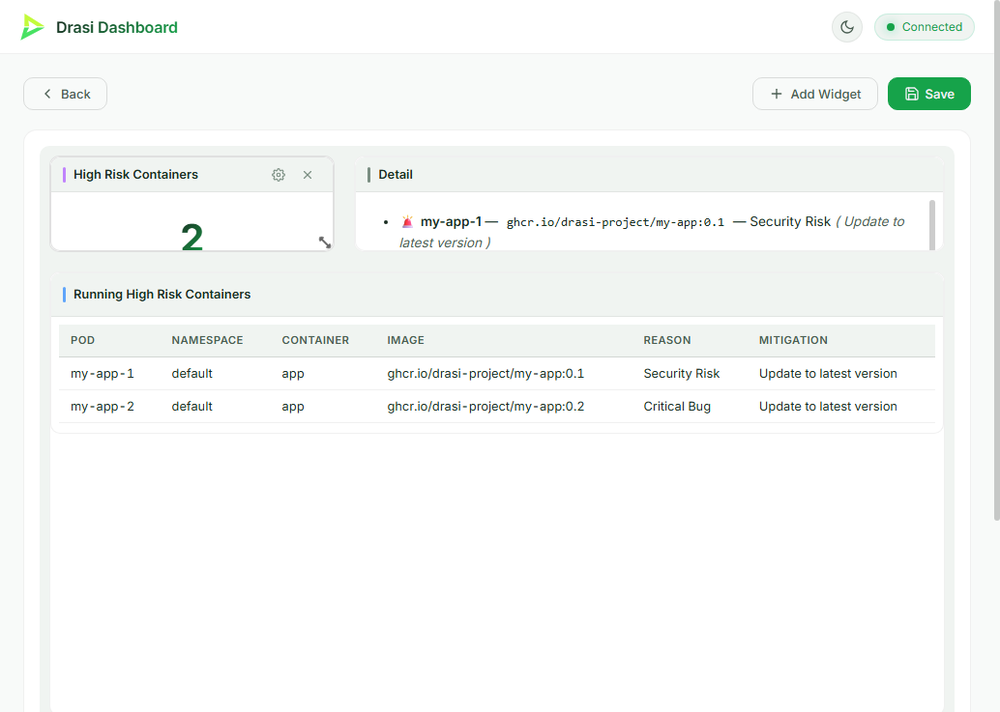

Imagine you keep a list of container images that are considered high risk
(known vulnerabilities, compliance problems, or images you don't want in
production), and want to know whenever one is used by a Pod in your Kubernetes
cluster. You don't want to write a controller or poll an API. You want to
describe the relationship between risky images and running applications, and
have something watch for the overlap continuously.

This tutorial builds a **High Risk Containers** dashboard on **Drasi Server**.
A PostgreSQL table holds risky image tags, a Kubernetes source watches real
Pods, and a reusable query publishes their container inventory. A second query
joins that inventory to the risky-image list. The **dashboard reaction** renders
the findings live, with no application code or bespoke web UI. An optional
**HTTP reaction** sends the same findings and resolutions to Discord or another
webhook endpoint.

The scenario stays small: two Pods, two initial risky-image records, one
dashboard, then an image flagged in PostgreSQL and a Pod upgraded in Kubernetes.
The reusable inventory is the computation-graph improvement: another query can
consume the same normalized containers without another Kubernetes watch or
another unwind pipeline.

| Step | What you'll do |
| ---- | -------------- |
| **[1. Set up](#setup)** | Build matching local Server, Core and plugins |
| **[2. Run](#run)** | Start an owned Kubernetes cluster, PostgreSQL and Server |
| **[3. Open the dashboard](#dashboard)** | See the initial high risk container |
| **[4. Drive change](#drive)** | Flag an image, upgrade a Pod, then reset |
| **[How it works](#how)** | Understand reusable results, the synthetic join and graph inspection |
| **[Optional webhook alerts](#discord)** | Send findings to Discord or a local receiver, then recover from a failed delivery |

{}
- Use two terminals, both in `tutorials/high-risk-containers/`. Terminal 1 runs Server in the foreground; Terminal 2 changes data.
- Default loopback ports are API `8380`, dashboard `3000`, PostgreSQL `5732` and Kubernetes API `6550`. Copy `.env.example` to `.env` before the first run to change them.
- Python commands below use `python3`; on Windows use `python` with Python 3.11 or newer. The existing `.sh` and `.ps1` helpers delegate to the same runner.
- The runner writes build provenance, ownership and a private kubeconfig under `.runtime/`. Do not copy this directory between machines or delete its ownership record while resources exist.
{}

## Step 1 of 4: Set Up Your Environment {#setup}

### Existing local checkouts

Use this directory layout, with the matching computation-graph versions already
checked out:

```text
workspace/
  drasi-core/
  drasi-server/
  learning-drasi-server/
```

Server must depend on the sibling `drasi-core/lib` by path. This tutorial does
not clone repositories, switch branches, download a released Drasi binary, or
install registry plugins. A released Server or an old plugin cache is not a
substitute for a matching local build.

### Option A: Local dev container

Open the existing `learning-drasi-server` folder in VS Code, select **Reopen in
Container**, and choose **Drasi Server - High Risk Containers Tutorial**. The
container mounts the parent directory so both sibling source checkouts are
available. Setup installs build prerequisites and builds local artifacts.

A Codespace containing only this tutorial repository is not sufficient: the
matching Core and Server checkouts must also be present. The local container
uses its own Docker-in-Docker engine, not a Docker Desktop installation; the
host workflow below defaults to Podman.

### Option B: Run on the host

Install Python 3.11+, the Rust toolchain named by the local checkouts (currently
1.95.0), the Server/Core native build prerequisites, **Podman**, **k3d** and
**kubectl**. Start a rootful Podman machine if your host needs one. k3d requires
Podman's Docker-compatible API, not just the `podman` CLI.

On macOS, inspect the socket and set it for these terminal sessions:

```bash
podman machine inspect --format '{{.ConnectionInfo.PodmanSocket.Path}}'
export DOCKER_HOST=unix:///the/socket/path/printed/above
```

On Linux use the endpoint of your rootful Podman API service. Configure that
service explicitly if it is not running; the tutorial will not change your
system settings or fall back to an unrelated Docker daemon.

Then build:

```bash
cd tutorials/high-risk-containers
python3 scripts/demo.py build
python3 scripts/demo.py verify-build
```

The shared builder compiles Server and these seven plugins from your local
Core checkout: `drasi-source-postgres`, `drasi-bootstrap-postgres`,
`drasi-source-kubernetes`, `drasi-bootstrap-kubernetes`,
`drasi-reaction-dashboard`, `drasi-reaction-http` and
`drasi-computation-transformer-query`. The last one runs the Cypher queries and
provides the `unwind` middleware used below. The builder records the checkout
revisions and the hash of every file it builds, and copies the plugins into a
private folder under `.runtime/`. Before each start the runner checks those
hashes, and Server loads plugins only from that folder, not from `PATH`,
`bin/plugins` or a global plugin cache. Plugin signature checks are skipped
only for this local build.

Re-run `build` after changing either checkout, with this tutorial's Server
stopped. `scripts/download.sh` and `scripts/download.ps1` run the same local
build; they do not download released binaries.

## Step 2 of 4: Run the Demo {#run}

In **Terminal 1**:

```bash
python3 scripts/demo.py start-demo
```

The first run allocates a unique run ID and records it in
`.runtime/ownership.json`. It:

1. Creates a k3d cluster with a private kubeconfig and a run-specific namespace,
   then deploys the original `my-app-1` (`ghcr.io/drasi-project/my-app:0.1`) and
   `my-app-2` (`:0.2`) Pods. It waits for both Pods to be ready.
2. Starts an owned PostgreSQL container and volume. An empty database is seeded
   with `my-app:0.1` as a *Security Risk* and `redis:6.2.3-alpine` as a
   *Compliance Issue*.
3. Starts the verified local Server/plugin bundle with a private copy of
   `server-config.yaml`, scoped to this cluster's kubeconfig and namespace.

It never switches your global kubectl context. All Kubernetes helpers specify
the private kubeconfig, named context and namespace. Existing resources are
reused only after ownership checks, not because their names happen to match.

Wait for:

```text
High Risk Containers READY: both sources, both queries and all reactions are running.
```

The runner prints this only after checking more than an open port: the
`runtime` endpoint reports this instance with `running: true`, every source,
query and reaction reports `Running`, no component of the computation graph has
failed or is waiting for another component, and the dashboard is being served.
If the message does not appear, read the Server log in Terminal 1; while Server
is still starting, `python3 scripts/demo.py graph` in Terminal 2 shows which
component has failed or is waiting. A missing Kubernetes tool, denied
list/watch permission, unavailable Kubernetes API or Pod image-pull failure
stops the run with an error.

Every start logs `WARN ... Table 'ContainerImage' does not exist, skipping`
from the PostgreSQL bootstrap. It is harmless: `ContainerImage` nodes come from
the `pod-containers` query, not from a PostgreSQL table.

The first image download can outlast the bounded 180-second Pod readiness wait.
Inspect it with `python3 scripts/demo.py kubectl get pods` and
`python3 scripts/demo.py kubectl describe pod my-app-1`. Resolve any image-pull
error; if downloading is simply slow, wait for both Pods to become Ready and
rerun `start-demo`. The helper checks ownership and reuses the same cluster and
Pods without resetting their images or the database.

### Startup and restart guarantees

**First start:** the database is seeded only when empty, and the two Pods are
created only when the owned namespace has no Pods. The PostgreSQL bootstrap
loads existing risks; Kubernetes bootstrap lists existing Pods. The
`pod-containers` query publishes its inventory snapshot, and
`high-risk-containers` bootstraps from that derived output plus the risk table
before maintaining live results.

**Normal restart:** Ctrl+C stops only Server. Run `start-demo` again, or use
`python3 scripts/demo.py start` when the cluster and database are already
running. Neither command resets risk rows or reapplies the original Pod image
tags. Query results are kept in memory, so at startup Server rebuilds them from
the current PostgreSQL rows and Pods. `persistConfig: false` means configuration
changes made through the REST API are not saved; put lasting changes in
`server-config.yaml`, then restart.

**What reactions see across a restart:** reactions receive only changes that
happen while Server is running. A finding that appears or is resolved while
Server is stopped shows up correctly in the rebuilt results and on the
dashboard, but the optional webhook reaction sends no message for it, and it
does not re-send findings that already exist when Server starts. Use the
dashboard or the query results API for the current state; do not treat webhook
messages as an audit log.

This tutorial keeps query indexes in memory rather than using the durable
indexes from Getting Started (Step 8). A query fed by the Kubernetes source
cannot resume from a saved index: with `persistIndex: true` the first start
works, but the next start stops with `source subscription requires
reset/rebootstrap before this query can resume`.

**Reset and cleanup are explicit:** `reset` changes only the tutorial's added
risk record and its two Pod images. `cleanup` deletes the owned cluster and
database container, preserving the database volume unless `--volumes` is passed.
After cleanup, a later start recreates the Pods at their original tags, while
retained database rows remain as you left them.

## Step 3 of 4: Open the Dashboard {#dashboard}

After the READY message, open <http://localhost:3000> (or your configured
dashboard port). In the dev container, use the **High Risk Containers Dashboard**
entry in VS Code's **Ports** panel.

The predefined dashboard contains:

- **High Risk Containers** KPI: count of matching containers.
- **Running High Risk Containers** table: Pod, namespace, container, image,
  reason and mitigation.
- **Detail**: a Markdown list of findings, or an all-clear message.

On a fresh run there is exactly one finding: **my-app-1**, running `my-app:0.1`,
with reason *Security Risk*. The risky Redis image has no matching Pod and does
not appear. Changes stream to the browser without refresh.



The image illustrates the dashboard layout; use the live table and the API
results to observe your run's actual state.

## Step 4 of 4: Drive Change {#drive}

### Flag a new high risk image

In **Terminal 2**:

```bash
python3 scripts/demo.py add-risk
```

This executes the following operation against **this run's** PostgreSQL
container, with safely quoted SQL parameters:

```sql
INSERT INTO "RiskyImage" ("Id", "Image", "Reason", "Mitigation")
VALUES (101, 'ghcr.io/drasi-project/my-app:0.2', 'Critical Bug', 'Update to latest version')
ON CONFLICT ("Id") DO UPDATE SET
  "Image" = EXCLUDED."Image",
  "Reason" = EXCLUDED."Reason",
  "Mitigation" = EXCLUDED."Mitigation";
```

**my-app-2** appears with reason *Critical Bug* and the KPI becomes **2**.
PostgreSQL CDC drives the risk join; the Pod did not change and the inventory
query did not need another watch or a re-unwind. The helper accepts image,
reason and mitigation arguments if you want to try another risk.

### Upgrade a Pod to a safe image

```bash
python3 scripts/demo.py upgrade
```

This runs `kubectl set image pod/my-app-2 app=ghcr.io/drasi-project/my-app:0.3`
against the private kubeconfig/context/namespace and waits until the container
reports that image and is running and ready. **my-app-2** leaves the findings
and the KPI returns to **1**. The risk row still exists in PostgreSQL; it no
longer joins to this Pod's image.

The query reads the Pod's **configured container image** (`spec.containers`),
not an image digest attestation or a container-health test. The result may
change before the replacement container finishes starting. The helper waits
for the actual new container to become ready so a failed rollout is not
reported as a successful upgrade.

### Reset and repeat

```bash
python3 scripts/demo.py reset
```

This deletes risk row `101` and recreates any tutorial Pod whose image was
changed, from `k8s/my-app.yaml` (`my-app-1` on `:0.1`, `my-app-2` on `:0.2`).
It does not drop the risk table or replication slot. The dashboard returns to
the single initial finding.

Recreating the Pod, rather than changing its image back in place, keeps the
reset fast when you repeat the exercise: each in-place image change restarts
the container, and Kubernetes waits longer before each further restart of the
same container (up to five minutes).

For direct Kubernetes inspection without touching your global context:

```bash
python3 scripts/demo.py kubectl get pods -o wide
```

## How It Works {#how}

### Two real sources

`devops` uses the PostgreSQL source and bootstrap plugins. The quoted,
PascalCase `"RiskyImage"` table and `"Image"`, `"Reason"` and `"Mitigation"`
columns match the labels and properties in the query. `REPLICA IDENTITY FULL`
supplies old values for deletes/updates; the primary key preserves identity.

`k8s` uses the Kubernetes source and bootstrap plugins. It lists and watches
Pods only in the owned namespace. Authentication uses the private kubeconfig
written by the runner. The source flattens each Pod into top-level properties
such as `name`, `namespace`, `labels`, `phase` and `containers` (the Pod's
`spec.containers` list); it does not pass on the whole Kubernetes JSON
document.

Server runs both sources, both queries and the reactions as connected
components of one computation graph. [Dashboard and graph
inspection](#inspect) shows how to see it.

### Normalize once, publish reusable container inventory

The `pod-containers` query attaches an unwind pipeline to its Kubernetes input:

```yaml
inputs:
  - component: k8s
    nodes: [Pod]
    pipeline: [extract-containers]
middleware:
  - kind: unwind
    name: extract-containers
    config:
      Pod:
        - selector: $.containers[*]
          label: Container
          key: $.name
          relation: OWNS
result:
  label: ContainerImage
query: |
  MATCH (p:Pod)-[:OWNS]->(c:Container)
  RETURN p.name AS pod, p.namespace AS namespace,
         c.name AS container, c.image AS image
```

Each nested container becomes a `Container` node, keyed by its name within the
Pod and connected to the Pod by an `OWNS` relation. `result.label:
ContainerImage` makes the query publish each result row as a `ContainerImage`
node, so another query can read the inventory the same way it reads nodes from
a source.

### Join the reusable output to risks

The downstream query consumes the inventory rather than subscribing to
Kubernetes again:

```yaml
- id: high-risk-containers
  autoStart: true
  queryLanguage: Cypher
  inputs:
    - component: pod-containers
    - component: devops
      nodes: [RiskyImage]
  result:
    label: HighRiskContainer
  joins:
    - id: HAS_IMAGE
      keys:
        - label: ContainerImage
          property: image
        - label: RiskyImage
          property: Image
  query: |
    MATCH (c:ContainerImage)-[:HAS_IMAGE]->(i:RiskyImage)
    RETURN c.pod AS pod, c.namespace AS namespace,
           c.container AS container, c.image AS image,
           i.Reason AS reason, i.Mitigation AS mitigation
```

The synthetic `HAS_IMAGE` join connects matching image strings across the two
systems. Inventory updates propagate through the derived graph output;
database changes update the same join from its other input. Dashboard and
Discord both subscribe to `high-risk-containers`, so neither duplicates that
join.

`nodes`, `relations` and `pipeline` select and reshape what a query reads from
a source. Leave them out when the input is another query: the downstream
`MATCH (c:ContainerImage)` already selects the published label, and Server
cannot start a query that sets them on a query input.

### Dashboard and graph inspection {#inspect}

The dashboard reaction subscribes to the risk query and streams its changes to
the browser over a WebSocket. The KPI counts rows, the table displays the six
fields, and the Markdown panel formats the same rows. The predefined layout is
created at startup.

To see how the components are connected, run in Terminal 2:

```bash
python3 scripts/demo.py graph
```

```text
Graph high-risk-containers-server (Running)

Components:
  devops                          Source     Running
  k8s                             Source     Running
  pod-containers                  Query      Running
  high-risk-containers            Query      Running
  high-risk-containers-dashboard  Reaction   Running
  (6 internal helper components hidden)

Connections:
  devops -> high-risk-containers
  k8s -> pod-containers
  pod-containers -> high-risk-containers  (data + bootstrap)
  high-risk-containers -> high-risk-containers-dashboard
```

`k8s` feeds only `pod-containers`. The risk query reads the inventory through
a query-to-query connection that carries live changes (`data`) and, at
startup, a snapshot of the current inventory (`bootstrap`). Server also creates
helper components inside each query; the command hides them. With the optional
webhook reaction enabled, `discord-alerts` appears as a second reaction of
`high-risk-containers`.

The command summarizes the graph inspection endpoint. `requests.http` contains
it and the other instance API requests, including:

```text
GET /api/v1/instances/high-risk-containers-server/runtime
GET /api/v1/instances/high-risk-containers-server/computation
GET /api/v1/instances/high-risk-containers-server/queries/e670943a-e9b5-45d4-9b88-c55ac28ce994/results
GET /api/v1/instances/high-risk-containers-server/queries/445f4635-64b3-48c4-9218-18c85c58b6f9/results
```

`python3 scripts/demo.py check` repeats the readiness checks and prints what
they read. `python3 scripts/demo.py inspect` prints the full inspection JSON,
including each component's lifecycle state, health, and any component it is
waiting for. A successful HTTP response or `running: true` alone does not prove
the data pipeline is ready; check component states and the actual results too.

## Optional: Webhook Alerts {#discord}

The dashboard is useful for watching; the **HTTP reaction** can also post a
message when a finding appears or is resolved. It reacts to real query changes;
nothing is sent on a timer. Send the messages to a Discord channel, or to a
small local receiver that prints them and needs no account. With the local
receiver you can also take the receiver offline and watch how the reaction
handles a delivery that fails.

### 1. Choose where messages go

**Discord:** open **Server Settings > Integrations > Webhooks > New Webhook**,
choose the channel and copy its URL. Treat that URL as a secret.

**Local receiver:** open a third terminal (Terminal 3) in
`tutorials/high-risk-containers/` and run:

```bash
python3 ../../scripts/webhook_receiver.py
```

```text
Listening on http://127.0.0.1:8390/ (Ctrl+C to stop)
```

Its webhook URL is `http://127.0.0.1:8390/`. Add `--port <number>` to use
another port. Like Discord, it answers each message with `204 No Content`.

### 2. Enable the reaction

`reaction/http` is already part of the locally built plugin bundle. Do not add
an OCI plugin reference or enable `autoInstallPlugins`.

In `server-config.yaml`, uncomment the `discord-alerts` block at the bottom,
keeping it aligned with the dashboard reaction in the instance's `reactions`
list. It subscribes to `high-risk-containers`; `added` and `updated` format
`after.*`, and `deleted` formats `before.*`, into Discord's
`{"content": "..."}` body. The update template also handles changes to a risk's
reason or mitigation. `recoveryPolicy: strict` is the default;
[step 5](#delivery-failure) shows what it does.

### 3. Restart Server with the webhook URL

Stop Server with Ctrl+C in Terminal 1, then set `DISCORD_WEBHOOK_URL` to your
Discord URL, or to `http://127.0.0.1:8390/` for the local receiver, and start
it again:



export DISCORD_WEBHOOK_URL="https://discord.com/api/webhooks/<id>/<token>"
# or, for the local receiver:
# export DISCORD_WEBHOOK_URL="http://127.0.0.1:8390/"
python3 scripts/demo.py start


$env:DISCORD_WEBHOOK_URL = "https://discord.com/api/webhooks/<id>/<token>"
# or, for the local receiver:
# $env:DISCORD_WEBHOOK_URL = "http://127.0.0.1:8390/"
python scripts/demo.py start



The URL is read at startup; it is not stored in the file. The database rows
and Pod images remain unchanged. With the reaction enabled, the READY check
also requires it to be running, and `python3 scripts/demo.py graph` lists
`discord-alerts` as a second reaction of `high-risk-containers`. The reaction
sends only changes that happen after it starts: there is no message for
`my-app-1`, which was already a finding.

### 4. Observe an alert and resolution

Reset first if you already completed Step 4. In Terminal 2:

```bash
python3 scripts/demo.py reset
python3 scripts/demo.py add-risk
python3 scripts/demo.py upgrade
```

Adding the risk makes **my-app-2** appear in the table and sends a detection
message; upgrading it to `:0.3` removes the finding and sends a resolution.
The local receiver prints both (the namespace is your run ID):

```text
[00:13:59] POST /
🚨 **High risk container detected**
• **Pod:** `my-app-2` (namespace `hrc-08b4dfe75ad7`)
• **Container:** `app`
• **Image:** `ghcr.io/drasi-project/my-app:0.2`
• **Reason:** Critical Bug
• **Mitigation:** Update to latest version

[00:14:01] POST /
✅ **High risk container resolved**
• **Pod:** `my-app-2`
• **Image:** `ghcr.io/drasi-project/my-app:0.2`
```

The same pattern works with other webhook endpoints by changing the URL and
templates.

### 5. Take the receiver offline {#delivery-failure}

This step needs the local receiver. In Terminal 2, run
`python3 scripts/demo.py reset`, then stop the receiver with Ctrl+C in
Terminal 3 and add the risk again:

```bash
python3 scripts/demo.py add-risk
```

**my-app-2** appears on the dashboard as before, but its message cannot be
delivered. Terminal 1 shows the reaction retrying and then stopping:

```text
WARN ... Transient HTTP request send error on attempt 1: error sending request for url (http://127.0.0.1:8390/); retrying
WARN ... Transient HTTP request send error on attempt 2: error sending request for url (http://127.0.0.1:8390/); retrying
ERROR ... Failed to process result: HTTP request failed after 3 attempts: error sending request for url (http://127.0.0.1:8390/)
ERROR ... Delivery failed for query '445f4635-64b3-48c4-9218-18c85c58b6f9' (seq 3); stopping per Strict recovery policy — the result replays from the outbox on restart
```

The sequence number depends on how many changes the query has produced. Check
the reaction by opening this URL in a browser (use your API port if you changed
it), or with `curl -s`:

```text
http://localhost:8380/api/v1/instances/high-risk-containers-server/reactions/discord-alerts
```

It reports `"status":"Error"` with an `error_message` that ends in `HTTP
delivery failed for query '445f4635-64b3-48c4-9218-18c85c58b6f9' (seq 3);
stopped per recovery policy`. The dashboard reaction is still `Running`: one
failed reaction does not stop the others.

Start the receiver again in Terminal 3 (`python3 ../../scripts/webhook_receiver.py`),
then start the reaction from Terminal 2:



curl -s -X POST http://localhost:8380/api/v1/instances/high-risk-containers-server/reactions/discord-alerts/start


Invoke-RestMethod -Method Post -Uri http://localhost:8380/api/v1/instances/high-risk-containers-server/reactions/discord-alerts/start



```json
{"success":true,"data":{"message":"Reaction started successfully"},"error":null}
```

The receiver immediately prints the detection message that failed, and the
reaction is `Running` again. Run `python3 scripts/demo.py upgrade` and the
resolution arrives as usual.

How the reaction handles failures:

- A request that cannot connect, or that gets a temporary error status (5xx,
  408, 409, 425 or 429), is tried up to three times, with a short wait that
  doubles between attempts.
- If the last attempt fails, or the endpoint answers 401, 403 or 407,
  `recoveryPolicy` decides. `strict` (the default) stops the reaction with an
  `Error` status and keeps the undelivered change; starting the reaction sends
  it and continues. Server does not start the reaction again by itself.
  `auto_skip_gap` instead logs `Delivery failed ... skipping and advancing
  checkpoint per AutoSkipGap recovery policy`, drops the change and keeps
  running.
- Any other 4xx response, such as 400 or 404, means the message can never be
  accepted. The reaction logs `Permanent HTTP request failure with status ...;
  dropping event` and keeps running under either policy.

The undelivered change is held in memory. If Server stops before you start the
reaction, the message is lost, and the restarted reaction does not send it.
Discord rejections appear in the Terminal 1 log in the same way.

## Clean Up {#cleanup}

Stop Server with Ctrl+C, then:

```bash
# Remove only this run's cluster and PostgreSQL container; retain database data.
python3 scripts/demo.py cleanup

# Also delete this run's database volume when you no longer need its data.
python3 scripts/demo.py cleanup --volumes
```

Cleanup verifies ownership labels and refuses to kill Server by process name or
delete unrelated clusters/volumes. It leaves build records and evidence in
`.runtime/`. If Server was forcibly killed and `server.lock` remains, verify
that the recorded process and its Server child are no longer running before
removing that one stale lock file.

## What You Learned {#summary}

- PostgreSQL CDC and a Kubernetes watch can maintain one live cross-system risk view.
- Unwind turns a nested container array into graph nodes; a query can publish a
  reusable, labeled inventory for downstream consumers.
- Synthetic joins connect that inventory to risk records without glue code.
- Dashboard and HTTP reactions share one maintained risk result set.
- The HTTP reaction retries failed deliveries; with the default `strict`
  recovery policy it stops with an `Error` status instead of losing a message,
  and delivers the held message when you start it again.
- Graph inspection (`demo.py graph` and the `computation` endpoint) shows how
  components connect and which have failed or are waiting, while explicit
  ownership and non-resetting startup keep the exercise safe to repeat.

### Check your local run

For a read-only comparison of both queries and the dashboard's row identities
with actual PostgreSQL rows and Kubernetes Pod specs:

```bash
python3 scripts/verify_demo.py
```

On an isolated run with no other writers, `--exercise` performs the add-risk,
risk-update, Pod-upgrade, reset and all-clear checks, then restores the original
inputs. It requires the two original Pods and only the two seeded risk rows:

```bash
python3 scripts/verify_demo.py --exercise --output .runtime/flow-evidence.json
python3 -m unittest discover -s scripts -p test_demo.py
```

These checks use real source data and the live dashboard reaction. They do not
prove external Discord delivery or exactly-once recovery.
