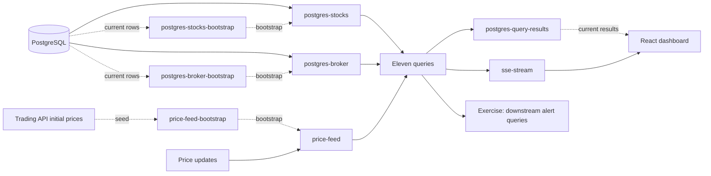

# Drasi Trading Demo

Build a live stock dashboard that joins simulated market prices with a PostgreSQL
watchlist and portfolio. Continuous queries maintain the watchlist, positions,
portfolio totals, sector summaries, market movers and order alerts; the browser
receives changes over one Server-Sent Events (SSE) connection instead of polling
the database.

**This is a simulation, not a brokerage integration.** All prices, holdings and
orders belong to a disposable local demo. No real accounts, transactions or
external market-data subscriptions are used.

## The application you will run

This tutorial runs the Trading application in the sibling
`drasi-server/examples/trading` folder, built against the sibling `drasi-core`
checkout. Application paths in this guide, such as `app/...`, `database/...`
and `mock-generator/...`, are relative to that folder.

Use this layout; the guide does not clone repositories or switch branches:

```text
computation-graph/
  drasi-core/
  drasi-server/
    dev-tools/react/
    examples/trading/
  learning-drasi-server/
    scripts/local_build.py
    tutorials/trading/       # run this guide's commands here
```

You will learn how one source can initialize and feed many queries, how to
inspect the components of a Server instance as one connected graph, and how a
query can build on another query's results instead of repeating its joins.

## 1. Build the matching local application

You need a running **Podman** machine, Python 3.11+, Node.js 22 or 24, and the
Rust build prerequisites documented by the local Core and Server checkouts.
Builds that share a Cargo target directory must run one at a time.

From `learning-drasi-server/tutorials/trading`:

```bash
python3 scripts/demo.py build
```

The build uses `scripts/local_build.py` to build the local Server and each of
these plugins from the local Core checkout:

| Package | Role |
| --- | --- |
| `drasi-computation-transformer-query` | Runs the continuous queries |
| `drasi-computation-source-postgres` | Streams PostgreSQL changes to the queries |
| `drasi-computation-bootstrap-postgres` | Reads current PostgreSQL rows for each query's initial results |
| `drasi-computation-source-http` | Receives simulated price updates over HTTP |
| `drasi-computation-bootstrap-http` | Loads the initial prices from the Trading API |
| `drasi-reaction-sse` | Streams query result changes to the browser |

The helper copies the plugins into a private folder under `.runtime/builds/`,
records their hashes and the checkout revisions, and refuses to start with
missing or changed files. It never downloads released binaries or registry
plugins. Rebuild after editing either checkout.

The build also compiles the Server's `native-postgres` example, a generator
for the application's component definitions, and the `@drasi/react` package in
`drasi-server/dev-tools/react`. `app/scripts/export-native-recipe.ts` passes the
eleven query definitions from `app/src/services/queries.ts`, with their inputs,
joins and result settings, to the generator. The generator writes every
component, connection and resource the application needs to
`drasi-server/examples/trading/app/public/native-computation.json`, and the app
installs that definition into Server when a run starts. Do not edit the file by
hand. It contains generated component IDs that change with every build, so a
build also changes this tracked file in your `drasi-server` checkout.

If a command reports missing Node or Python dependencies, install them for the
Server example, then rerun the build:

```bash
npm --prefix ../../../drasi-server/dev-tools/react ci --ignore-scripts
npm --prefix ../../../drasi-server/examples/trading/app ci --ignore-scripts
python3 -m venv .runtime/venv
.runtime/venv/bin/python -m pip install \
  -r ../../../drasi-server/examples/trading/mock-generator/requirements.txt
```

If you created that environment, use `.runtime/venv/bin/python` instead of
`python3` for the commands below. When Cargo's dependencies are already cached,
`CARGO_NET_OFFLINE=true` keeps it offline; `CARGO_BUILD_JOBS=1` limits parallel
compilation on small machines.

## 2. Start the full dashboard

```bash
python3 scripts/demo.py run
```

The launcher starts a fresh PostgreSQL container loaded with the example's
`database/init.sql`: **50 stocks, eight portfolio positions**, watchlist
entries and the order tables. It then starts the Trading API, the local Server,
the app's setup step (which installs the generated components into Server),
the dashboard's Vite development server and the simulated price generator:

```text
Ready: fresh PostgreSQL
Ready: Trading API
Ready: trading-server running
Ready: Trading dashboard

Dashboard: http://127.0.0.1:54514
Run directory: .../tutorials/trading/.runtime/run-y87kw6n3
Ctrl+C stops only this run and removes its disposable database. Logs are retained.
```

Every service uses a new loopback-only port, so your URLs and run directory
differ. Open the printed **Dashboard** URL and note the **Run directory**: its
`endpoints.json` lists the actual Server, price source, SSE, API and dashboard
URLs, and each service's log is next to it.

Prices start changing once all eleven queries are `Running`: the price
generator sends one price for each of the 50 stocks, then updates three to
eight random symbols every one to three seconds. The run directory's
`prices.log` lists each update it sends.

The launcher creates no persistent database volume and never reuses another
run's resources; `.runtime/server.lock` prevents a second run from starting
while one is active. **Ctrl+C stops only this run and removes its disposable
database; logs remain.** Use this launcher instead of the example's own
`start-demo.sh` and `stop-demo.sh`, which use fixed container names and ports.

### What to observe

| Dashboard area | Continuous query | Expected behavior |
| --- | --- | --- |
| Watchlist | `watchlist-query` | Joins selected symbols to company names and changing prices |
| Portfolio | `portfolio-query` | Revalues each position as price or quantity changes |
| Portfolio totals | `portfolio-summary-query` | Maintains one current value/cost/profit summary |
| Sector performance | `sector-performance-query` | Updates counts, volume and price aggregates |
| Gainers / losers | `top-gainers-query`, `top-losers-query` | Rows enter or leave when prices cross previous close |
| High volume | `high-volume-query` | Includes prices with volume over 10,000,000 |
| Ticker | `price-ticker-query` | Streams the 50 simulated symbols |
| Orders / timed alerts | `active-orders-query`, `stale-orders-query`, `expiring-orders-query` | Joins demo orders to prices and evaluates time conditions |

Before editing the simulated portfolio, check the initial results in another
terminal:

```bash
python3 scripts/demo.py verify .runtime/run-REPLACE-WITH-YOUR-RUN
```

```text
All eleven queries running; full initial snapshots saved to .../.runtime/run-y87kw6n3/snapshots.json
```

This checks that `trading-server` is running, that all eleven queries are
`Running`, and that their results contain all 50 prices, the eight positions
and a single portfolio summary row. It saves every query's results to the run's
`snapshots.json`. A healthy HTTP endpoint alone does not prove readiness.

## 3. Cause a database change and watch it arrive

In **Watchlist**, add a stock not already listed. Its name and latest price
should appear without refreshing the browser. Remove the same watchlist entry
and observe its row disappear.

In **Portfolio**, edit one existing demo position's quantity. Its value, cost
basis and profit/loss change, and the summary updates from the query results.
At the seed prices (as in a `--no-prices` run), changing Apple (AAPL) from 100
to 110 shares raises that position's value from 17,550 to 19,305 and the
portfolio's total value from 119,862 to 121,617. Restore the original quantity
afterward. These controls write to the isolated Trading API and database; the
UI update comes back through PostgreSQL change data capture (CDC) and SSE, not
an optimistic replacement of the query result.

Reload the page. The app reads each query's current results again, so it shows
current holdings and totals rather than accumulated history, and it connects to
the components already installed instead of installing another copy.
Connection and request errors stay visible; **Retry connection** only retries
the connection.

The Orders panels use the simulated order workflow. `drasi.trueFor` evaluates
stale and expiry conditions as time passes. A query alert does not update an
order's status or execute a trade; the simulated order API owns those actions.
Nothing in this tutorial authorizes real trading.

## 4. Follow one price through the graph

List the instance's components and how they are connected:

```bash
python3 scripts/demo.py graph .runtime/run-REPLACE-WITH-YOUR-RUN
```

```text
Graph trading-server (Running)

Components:
  postgres-broker            Source             Running
  postgres-stocks            Source             Running
  price-feed                 Source             Running
  postgres-broker-bootstrap  BootstrapProvider  Running
  postgres-stocks-bootstrap  BootstrapProvider  Running
  price-feed-bootstrap       BootstrapProvider  Running
  active-orders-query        Query              Running
  ...
  watchlist-query            Query              Running
  postgres-query-results     Sink               Running
  sse-stream                 Reaction           Running

Connections:
  postgres-broker -> active-orders-query  (data + bootstrap)
  ...
  postgres-stocks -> portfolio-query  (data + bootstrap)
  ...
  price-feed -> portfolio-query  (data + bootstrap)
  ...
  postgres-broker-bootstrap -> postgres-broker  (bootstrap)
  postgres-stocks-bootstrap -> postgres-stocks  (bootstrap)
  price-feed-bootstrap -> price-feed  (bootstrap)
  active-orders-query -> postgres-query-results
  active-orders-query -> sse-stream
  ...
```

The command summarizes Server's graph inspection endpoint
(`GET /api/v1/instances/trading-server/computation`); `...` marks lines
left out here. Follow `price-feed` to see where one price goes:



**Shared sources.** `postgres-stocks` reads the `stocks`, `portfolio` and
`watchlist` tables and feeds seven queries; `postgres-broker` reads
`limit_orders` and feeds the three order queries. Each uses a single
replication slot for all of its queries, and the generated definition lists
those queries so the source can track how far each one has read. You do not
need a separate PostgreSQL source for each panel. `price-feed` receives price
updates over HTTP and feeds the nine queries that use prices.

**Initial results.** Each source has its own bootstrap provider component.
The PostgreSQL providers read the current rows; `price-feed-bootstrap` loads
the price seed from the Trading API's `/api/initial-prices`. A provider feeds
its source's bootstrap input, and the source passes a snapshot to each of its
queries: that is the `bootstrap` half of `data + bootstrap`. A query that joins
PostgreSQL rows with prices, such as `portfolio-query`, receives a snapshot
from both sources, because the database alone cannot fill in a join that also
needs prices.

**Outputs.** Every query feeds two components. `postgres-query-results` keeps
each query's current results for the results API
(`GET /api/v1/instances/trading-server/queries/{id}/results`), which the
dashboard reads first. `sse-stream`, the SSE reaction, then sends each change
as a JSON message with `queryId`, `results` and `timestamp`; each entry in
`results` has a `type` (`ADD`, `UPDATE` or `DELETE`) and the row's `data`,
plus `before` and `after` values for updates.

The app installs all eleven queries before prices start, and the price
generator waits until they are all `Running`, so no query misses an update.
The HTTP source cannot replay updates it has already accepted, and query state
is kept in memory, so every run starts from a fresh database and fresh query
state.

### Current query declarations

`app/src/services/queries.ts` declares each query. For example:

```typescript
{
  id: 'portfolio-query',
  inputs: ['postgres-stocks', 'price-feed'],
  joins: [OWNS_STOCK, HAS_PRICE],
  // query: the existing portfolio projection
}
```

`inputs` lists the upstream sources, queries or transformers: by name
(`'price-feed'`), by ID (`{ id: '<uuid>' }`), or as an object that also selects
an output port (`{ component: 'price-ticker-query', port: 'out' }`). A query's
`result.label` sets the label of the nodes it publishes for downstream queries;
the Trading queries keep the default label, `Result`.

Synthetic joins connect data from different sources without foreign keys:
`HAS_PRICE` joins stock and price nodes on `symbol`, `OWNS_STOCK` joins
positions to stocks, and `ON_WATCHLIST` joins selected symbols to stocks.
Sorting and row limits stay in the UI; continuous queries do not support
`ORDER BY` or `LIMIT`.

## 5. Reuse a query result instead of repeating its work

For a repeatable exercise, stop your run with Ctrl+C and start a fresh one
without random price updates:

```bash
python3 scripts/demo.py run --no-prices
```

Initial data still comes from the PostgreSQL and Trading API bootstrap
providers. Open the printed dashboard. In another terminal, use the new run
directory:

```bash
export TRADING_RUN="$PWD/.runtime/run-REPLACE-WITH-YOUR-RUN"
python3 scripts/exercise.py "$TRADING_RUN"
```

The exercise creates this query through the instance's REST API:

```json
{
  "id": "10461b0d-336b-4084-8cc9-1fd20c647c1a",
  "name": "tutorial-price-alerts",
  "queryLanguage": "Cypher",
  "query": "MATCH (p:Result) WHERE p.price > 200 RETURN p.symbol AS symbol, p.price AS price",
  "inputs": [{"id": "adcf3898-5db4-4c1f-a5d4-207f1a85f277"}],
  "result": {"label": "PriceAlert"},
  "autoStart": true
}
```

Its input is **the ticker query**, selected by ID, not another HTTP or
PostgreSQL source. The exercise reads that ID from the run's `endpoints.json`;
IDs change with every build, so yours differs from the one shown. The new
query's first results must already include the qualifying stocks, before any
new price arrives. A second query, `tutorial-price-alert-count`, reads the
`PriceAlert` nodes this query publishes and counts them, which shows the
`result.label` setting at work.

The exercise temporarily adds AAPL to the watchlist through the Trading API if
it is not already listed, then sends AAPL above the threshold and below it to
the HTTP price source. Watch the ticker, watchlist, portfolio value and market
movers change in the same dashboard. It checks that AAPL enters and leaves the
alert results and that the count changes in both directions, then restores
AAPL's seed price:

```text
Ready: temporary AAPL watchlist entry through real PostgreSQL CDC
Ready: tutorial-price-alerts
Ready: tutorial-price-alert-count
Ready: downstream snapshot without new price events
Ready: AAPL 210.0: original dashboard calculations plus both downstream queries
Observe the dashboard price, positions and market movers.
Ready: AAPL 170.0: original dashboard calculations plus both downstream queries
Observe the dashboard price, positions and market movers.
Ready: restored AAPL seed price
Ready: original watchlist restored through CDC
Snapshot/live chaining verified; seed restored and exercise queries removed: .../chaining.json
```

The two exercise queries and any watchlist entry it added are removed
afterward; the eleven installed queries are unchanged. The results it observed
are saved in the run directory's `chaining.json`.

The exercise queries read only the ticker query's results, so neither
PostgreSQL source gains a query. To add a query to the installed set itself,
change `app/src/services/queries.ts`, rebuild with `demo.py build` and start a
fresh run.

## React integration and source map

The dashboard uses the local `@drasi/react` package. `DrasiClient` is given
the instance, the eleven query IDs and the SSE reaction. Each hook reads its
query's current results and then applies live changes from the SSE stream;
after a reconnect it reads the current results again, with a bounded number of
retries. The app's `TradingProvider` installs the generated components only when
connecting fails because a Trading query or the SSE reaction is missing,
stopped or still starting; it then connects once more.

All application paths below are relative to `drasi-server/examples/trading`:

| File | Responsibility |
| --- | --- |
| `server/trading-sources-only.yaml` | Server configuration with an empty instance; the app installs every component |
| `server/trading-native-recipe.json` | Source settings read by the generator, with connection values from environment variables |
| `app/scripts/export-native-recipe.ts` | Actual query definitions to native generator |
| `app/public/native-computation.json` | Generated components, connections and resources (do not edit) |
| `app/src/services/queries.ts` | Eleven original projections and synthetic joins |
| `app/src/drasi/TradingProvider.tsx` | Connects the dashboard; installs components when they are missing |
| `app/src/drasi/ensureTradingResources.ts` | Checks and installs the complete set of components |
| `app/src/services/TradingApi.ts` | Isolated simulated watchlist/portfolio/order API |
| `mock-generator/trading_api.py` | Demo API and initial price endpoint |
| `mock-generator/simple_price_generator.py` | Gated simulated price updates |

## Troubleshooting and qualification

**Missing or changed local build:** stop the tutorial and rebuild. The local
`--skip-verification` flag applies only to the hashed local build; do not use it
for downloaded plugins.

**Source or initialization error:** read the run's `server.log` and
`trading-api.log`, and run `python3 scripts/demo.py graph <run directory>` to
see which component failed or is waiting. Do not reset an existing replication slot or work around a failed
input.

**Startup lock:** confirm the recorded owner process is gone before removing
this tutorial's stale `.runtime/server.lock`. Never stop processes by name or
another run's containers.

**Browser connection:** use the newly printed URL and inspect its EventSource
connection; an older dashboard can target a different run. The launcher
disables Server's optional built-in UI, which the Trading dashboard does not
use.

For a broader automated check, the Server repository has
`examples/postgres/qualify-trading.py`. Give it the local build's Server,
bundle generator and plugin directory, a new evidence directory, and a Python
interpreter with the Trading API requirements. It uses an isolated Podman
database, the app's setup step, joined snapshots, live database and price
changes, rollback handling and the real SSE stream, with a smaller dataset than
the 50-stock tutorial.

See [Contributing and exercises](CONTRIBUTING.md) for scoped follow-on work.

## License

Copyright 2025 The Drasi Authors. Licensed under the Apache License, Version 2.0.
