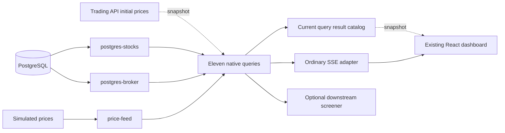

# Drasi Trading Demo

Build a live stock dashboard that joins simulated market prices with a PostgreSQL
watchlist and portfolio. Continuous queries maintain the watchlist, positions,
portfolio totals, sector summaries, market movers and order alerts; the browser
receives changes over one SSE connection instead of polling the database.

**This is a simulation, not a brokerage integration.** All prices, holdings and
orders belong to a disposable local demo. No real accounts, transactions or
external market-data subscriptions are used.

## The application you will run

Use the **existing sibling `drasi-server/examples/trading` application** with the
current sibling `drasi-core`. The older copied `app/`, `database/` and
`mock-generator/` directories here are not the runnable entry point: they do not
include the current Server configuration, native bundle generator or reusable
React package. This tutorial does not maintain another copy of that application.

Start with this existing layout; do not clone another Server/Core or switch
branches to follow the guide:

```text
computation-graph/
  drasi-core/
  drasi-server/
    dev-tools/react/
    examples/trading/
  learning-drasi-server/
    scripts/local_build.py
    tutorials/trading/       # run this guide's commands here
```

You will learn how shared sources initialize multiple real query consumers, how
ordinary APIs and native components use the same computation graph, and how a
downstream query can reuse a published result instead of repeating a source join.

## 1. Build the matching local application

You need a running **Podman** machine, Python 3.11+, Node.js 22 or 24, and the
Rust/native build prerequisites documented by the local Core and Server
checkouts. On macOS, use their established jq/LLVM and Rust environment. Builds
sharing the same Cargo target must run one at a time.

From `learning-drasi-server/tutorials/trading`:

```bash
python3 scripts/demo.py build
```

The build uses `scripts/local_build.py` to build the local Server and **each**
of these local Core plugin packages separately:

| Package | Role |
| --- | --- |
| `drasi-computation-source-postgres` | Shared PostgreSQL CDC |
| `drasi-computation-bootstrap-postgres` | Per-consumer PostgreSQL snapshots |
| `drasi-computation-source-http` | Live simulated price ingestion |
| `drasi-computation-bootstrap-http` | Initial prices from the real Trading API |
| `drasi-reaction-sse` | Existing browser SSE output adapter |

Path dependencies rebuild the Server, **not** its dynamically loaded plugins.
The helper copies a matching private bundle into `.runtime/builds/`, records
hashes and repository provenance, and refuses missing or changed artifacts.
There is no released binary, registry plugin fallback or prebuilt Drasi image.
Rebuild after editing either source checkout.

Trading also builds the Server's `native-postgres` example and the existing
`@drasi/react` package. Its `app/scripts/export-native-recipe.ts` exports the actual
eleven query definitions, retaining their `inputs`, joins and result settings.
The native generator loads the actual factories and writes
`drasi-server/examples/trading/app/public/native-computation.json`.
Do not hand-author its ports, factory metadata or secret resource bindings.

If a command reports missing Node/Python dependencies, prepare **the existing
application**, then rerun the build:

```bash
npm --prefix ../../../drasi-server/dev-tools/react ci --ignore-scripts
npm --prefix ../../../drasi-server/examples/trading/app ci --ignore-scripts
python3 -m venv .runtime/venv
.runtime/venv/bin/python -m pip install \
  -r ../../../drasi-server/examples/trading/mock-generator/requirements.txt
```

Use `.runtime/venv/bin/python` instead of `python3` for subsequent commands if you
created that environment. Do not install into a different Trading copy. With
cached Rust dependencies, `CARGO_NET_OFFLINE=true` keeps Cargo offline;
`CARGO_BUILD_JOBS=1` bounds compilation. Neither setting substitutes for a
matching build.

## 2. Start the full dashboard safely

```bash
python3 scripts/demo.py run
```

The foreground launcher starts a fresh PostgreSQL container with the existing
Trading `database/init.sql`: **50 stocks, eight portfolio positions**, watchlist
entries and the order tables. It then starts the real Trading API, the local
Server, the app-owned native setup, Vite and the simulated price generator.

Every service uses a new loopback-only port. Open the **Dashboard** URL printed
by the launcher, not an old `localhost:5273` installation. Record its **Run
directory** for the commands below. `endpoints.json` in that directory contains
the actual Server, source, SSE, API and browser URLs; logs are alongside it.
The app uses `VITE_DRASI_SERVER_URL`, `VITE_TRADING_API_URL` and the
`VITE_TRADING_SSE_*` settings to target this run, including portfolio actions.

The launcher never uses the old fixed-name Docker Compose/start/stop scripts.
It creates no persistent database volume, does not reuse a running demo, does
not reset a replication slot, and refuses a second owner through `server.lock`.
**Ctrl+C stops only this run and removes its disposable database; logs remain.**
Use this isolated entry point instead of `start-demo.sh`, `stop-demo.sh`,
`clean-replication.sh` or a volume-reset command.

### What to observe

| Dashboard area | Continuous query | Expected behavior |
| --- | --- | --- |
| Watchlist | `watchlist-query` | Joins selected symbols to company names and changing prices |
| Portfolio | `portfolio-query` | Revalues each position as price or quantity changes |
| Portfolio totals | `portfolio-summary-query` | Maintains one current value/cost/profit summary |
| Sector performance | `sector-performance-query` | Updates counts, volume and price aggregates |
| Gainers / losers | `top-gainers-query`, `top-losers-query` | Rows enter or leave when prices cross previous close |
| High volume | `high-volume-query` | Includes prices with volume over 10,000,000 |
| Ticker | `price-ticker-query` | Streams the 50 simulated symbols |
| Orders / timed alerts | `active-orders-query`, `stale-orders-query`, `expiring-orders-query` | Joins demo orders to prices and evaluates time conditions |

Before editing the simulated portfolio, check the initial snapshots in another
terminal:

```bash
python3 scripts/demo.py verify .runtime/run-REPLACE-WITH-YOUR-RUN
```

This requires the correct running `trading-server` ComputationGraph, all eleven
queries Running, all 50 prices, eight positions and a singleton portfolio
summary. It writes the actual snapshots to that run's `snapshots.json`.
A healthy HTTP endpoint alone is not readiness.

## 3. Cause a database change and watch it arrive

In **Watchlist**, add a stock not already listed. Its name and latest price
should appear without refreshing the browser. Remove the same watchlist entry
and observe its row disappear.

In **Portfolio**, edit one existing demo position's quantity. Its value, cost
basis and profit/loss change, and the summary updates from the query results.
Restore the original quantity afterward. These controls write to the isolated
Trading API and database; the UI update comes back through PostgreSQL CDC and
SSE, not an optimistic replacement of the query result.

Reload the page. The app must show current holdings and totals, not append
historical aggregate rows. It reconnects to the existing source/query group
instead of provisioning another copy. Its connection and request errors remain
visible; **Retry connection** is not permission to overwrite an incompatible
deployment.

The Orders panels retain the original simulated workflow. `drasi.trueFor`
evaluates stale/expiry conditions as time passes. A query alert is not itself
a database status update or execution of a trade; the local simulated order/API
workflow owns those actions. Nothing in this tutorial authorizes real trading.

## 4. Follow one price through the graph



There is **one ComputationGraph**, not a separate runtime for the ordinary REST
APIs or SSE reaction. Native query outputs use the same graph-change schema as
source and transformer outputs. Result nodes carry canonical identity, a label
and projected properties; consumers can handle additions, replacements, patches
and deletions without a second query-only graph protocol.

The existing SSE *reaction adapter* intentionally exposes its browser-facing
query-result envelope (`queryId`, `results`, `timestamp`). Do not confuse that
adapter's wire format with a native SSE sink's graph-change frames, and do not
parse source changes as query rows. A native sink can consume source, query or
transformer outputs when configured for them; switching this application's SSE
plugin requires its matching client adapter and snapshot contract.

### Shared sources, separate initialization boundaries

`postgres-stocks` is shared by the actual stock/watchlist/portfolio consumers.
`postgres-broker` is shared by the actual order-query consumers. Their
`consumerProgress` resources name real query owners, so creating a second
PostgreSQL source for each panel is unnecessary.

Each query still owns its snapshot boundary. Mixed PostgreSQL/HTTP queries bind
a `compositeBootstrap` containing both native bootstrappers: the database alone
cannot initialize a join that also needs prices. The real Trading API serves
the bounded original price seed at `/api/initial-prices`.

The app installs the complete fixed-member native group before live prices
start. The generator waits for all its query owners to be Running.
This HTTP source has **no atomic replay cursor**: that ordering is not a
durable, gap-free HTTP recovery guarantee. This tutorial uses fresh in-memory
query state and a fresh database on every run, not a persistent recovery test.

### Current query declarations

The local `app/src/services/queries.ts` uses:

```typescript
{
  id: 'portfolio-query',
  inputs: ['postgres-stocks', 'price-feed'],
  joins: [OWNS_STOCK, HAS_PRICE],
  // query: the existing portfolio projection
}
```

`inputs` accepts source, query and transformer component names, or explicit
objects such as `{ component: 'price-ticker-query', port: 'out' }`.
The removed `sources` and `sourceId` subscription fields are not accepted.
`result: { label: 'PortfolioPosition' }` would name the published result nodes;
it does **not** define a different output schema. The existing Trading queries
use the default `Result` label.

Synthetic joins retain the same business meaning: `HAS_PRICE` joins stock and
price nodes on `symbol`, `OWNS_STOCK` joins positions to stocks, and
`ON_WATCHLIST` joins selected symbols to stocks. Presentation sorting and row
limits remain in the UI; continuous queries do not support `ORDER BY`/`LIMIT`.

## 5. Reuse a query result instead of repeating its work

For a deterministic exercise, stop your run with Ctrl+C and start a fresh one
without random live prices:

```bash
python3 scripts/demo.py run --no-prices
```

Initial data still comes from the real native PostgreSQL/HTTP bootstraps. Open
the printed dashboard. In another terminal, copy the new run directory:

```bash
export TRADING_RUN="$PWD/.runtime/run-REPLACE-WITH-YOUR-RUN"
python3 scripts/exercise.py "$TRADING_RUN"
```

The exercise creates this ordinary query through the instance-scoped REST API:

```json
{
  "id": "tutorial-price-alerts",
  "queryLanguage": "Cypher",
  "query": "MATCH (p:Result) WHERE p.price > 200 RETURN p.symbol AS symbol, p.price AS price",
  "inputs": ["price-ticker-query"],
  "result": { "label": "PriceAlert" },
  "autoStart": true
}
```

It consumes **the ticker query**, not a duplicate HTTP or PostgreSQL source.
Its initial result must include already-qualifying stocks before any new price
arrives. A second query reads `PriceAlert` nodes from this result and counts
them, making the `result.label` boundary observable.

The exercise temporarily adds AAPL to the watchlist through the real Trading
API if it is not already listed, then sends AAPL above the threshold and below it to the real
HTTP price source. Watch the ticker, watchlist, portfolio value and market
movers change in the same dashboard. It checks that AAPL enters and exits the
downstream alert result and that the count changes in both directions, then
restores AAPL's seed price. The two new queries and any watchlist entry it added
are removed afterward; the native fixed-member group is unchanged. Captured initial/live/restored results
are saved in the run directory.

This addition does not recruit another PostgreSQL snapshot consumer. Changing
the native group's own members is different: regenerate its bundle and use a
fresh isolated run rather than append a late consumer at the current WAL head.

## React integration and source map

The current application imports the local `@drasi/react` package. Its app-owned
`TradingProvider` provisions known resources only on eligible typed setup
failures; the reusable client remains connect-only. `DrasiClient` receives
`outputIds`, the explicit instance and one SSE reaction reference. Hooks obtain
a current snapshot and then apply live changes; reconnects refresh snapshots
with bounded retries rather than claiming an atomic snapshot/stream handoff.

All application paths below are relative to `drasi-server/examples/trading`:

| File | Responsibility |
| --- | --- |
| `server/trading-sources-only.yaml` | Empty instance; no unowned PostgreSQL producer starts early |
| `server/trading-native-recipe.json` | Source recipes and environment-based connection references |
| `app/scripts/export-native-recipe.ts` | Actual query definitions to native generator |
| `app/public/native-computation.json` | Generated canonical component/resource/pipe definitions |
| `app/src/services/queries.ts` | Eleven original projections and synthetic joins |
| `app/src/drasi/TradingProvider.tsx` | App lifecycle and read-only connection |
| `app/src/drasi/ensureTradingResources.ts` | Full native-group preflight and setup |
| `app/src/services/TradingApi.ts` | Isolated simulated watchlist/portfolio/order API |
| `mock-generator/trading_api.py` | Real demo API and initial price endpoint |
| `mock-generator/simple_price_generator.py` | Gated simulated price updates |

## Troubleshooting and qualification

**Missing/incompatible local artifact:** stop the tutorial and rebuild. Local
`--skip-verification` is limited to the explicitly hashed development bundle;
it is not a recommendation to disable verification for downloaded plugins.

**Source/initialization error:** inspect the run's `server.log` and
`trading-api.log`. Missing snapshots, unavailable PostgreSQL/WAL, partial native
groups and mismatched definitions must remain errors. Do not reset an existing
slot or replace failed input with synthetic success.

**Startup lock:** confirm the recorded owner process is gone before removing
only this tutorial's stale `.runtime/server.lock`. Never terminate processes
by name or stop another run's containers.

**Browser connection:** use the newly printed URL and inspect its EventSource
connection. An older dashboard or hardcoded port can target a different demo.
The launcher disables the optional embedded Server UI; Trading's data dashboard
does not depend on those assets.

For additional real-runtime qualification, the Server has
`examples/postgres/qualify-trading.py`. Supply the local build's recorded Server,
native generator and five-library directory, a new evidence directory, and a
Python interpreter with the Trading API requirements. It uses an isolated
Podman database, actual app setup, joined snapshots, live CDC/price changes,
rollback exclusion and real SSE. Its smaller qualification dataset is not the
50-stock interactive tutorial. App integration fixtures are useful separately
but do not prove native runtime behavior.

See [Contributing and exercises](CONTRIBUTING.md) for scoped follow-on work.

## License

Copyright 2025 The Drasi Authors. Licensed under the Apache License, Version 2.0.
